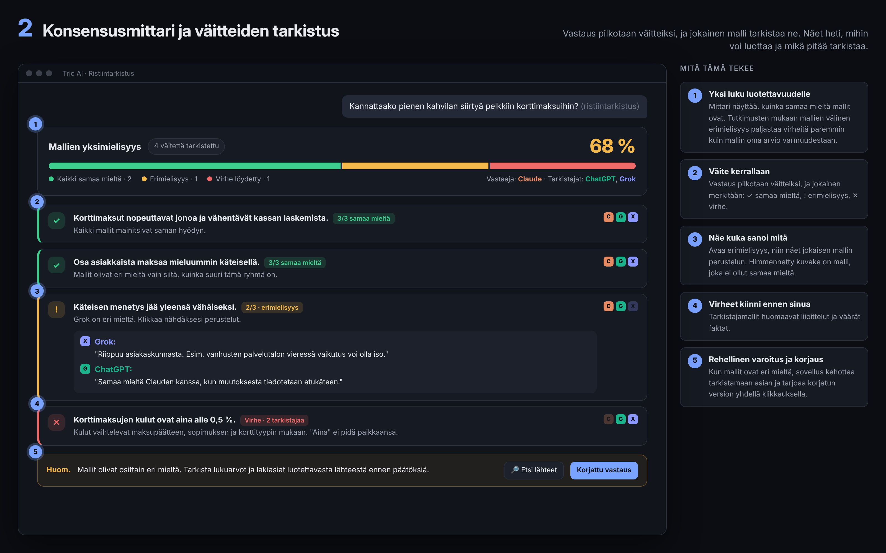
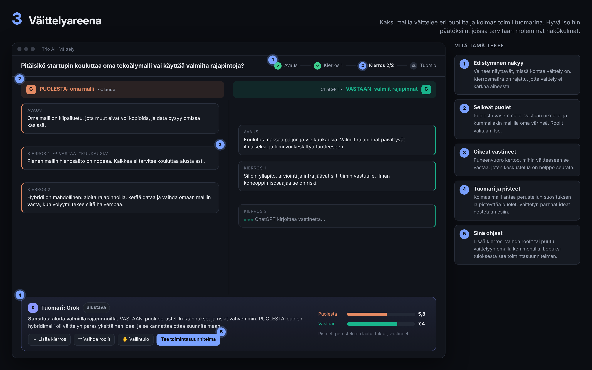
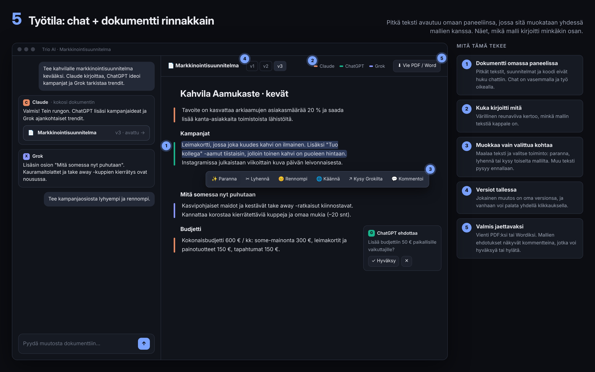
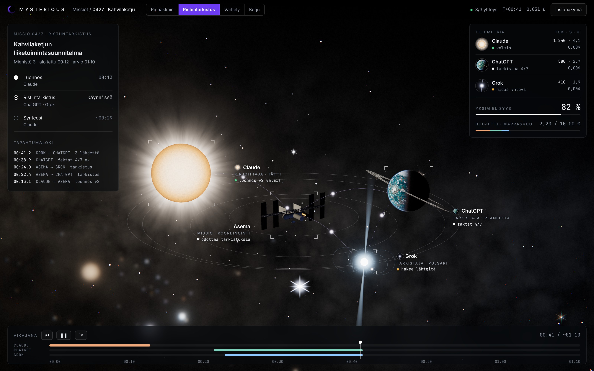
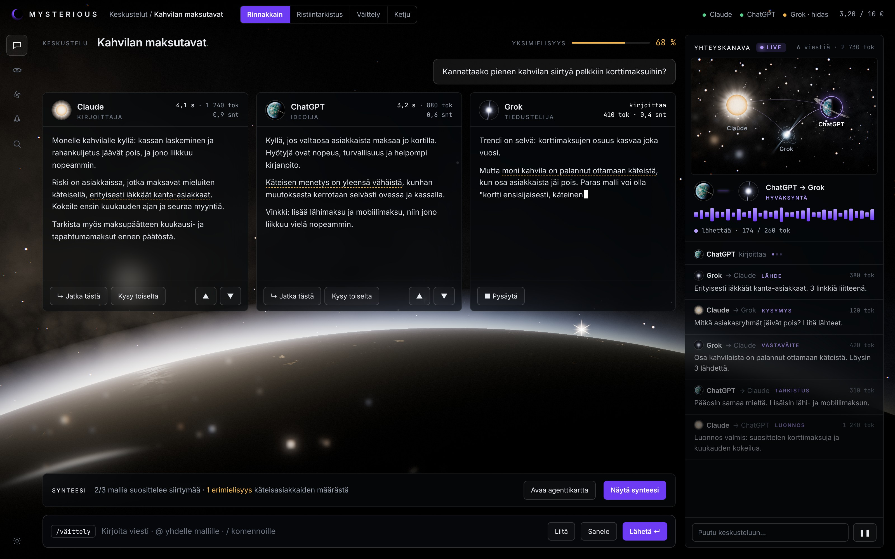
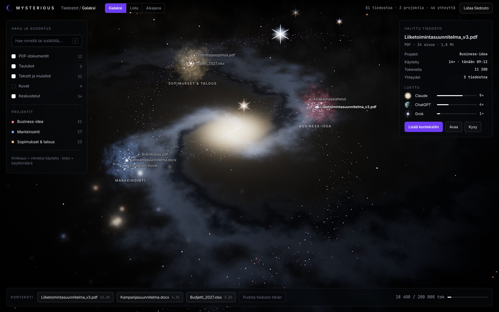
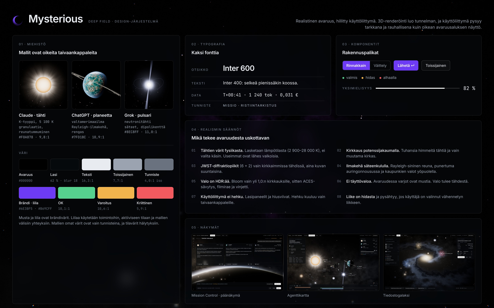

# Mysterious: tuotesuunnitelma ja ideapankki (Claude + ChatGPT + Grok)

> **Ohje Claudelle (lue ensin):**
> Tämä tiedosto on sovelluksen tuotesuunnitelma ja ideapankki. Sovelluksessa Claude (Anthropic), ChatGPT (OpenAI) ja Grok (xAI) toimivat yhdessä.
> 1. **Lue osio 0 (tuotevisio) ensin.** Se määrää suunnan kaikille muille päätöksille.
> 2. Tutustu olemassa olevaan koodiin: rakenne, kirjastot, miten mallien API-kutsut on tehty ja mitä tämän tiedoston ominaisuuksista on jo toteutettu.
> 3. Kerro käyttäjälle lyhyesti, mitkä ideat ovat jo valmiina, mitkä osittain ja mitkä puuttuvat.
> 4. Ehdota toteutusjärjestys (ks. osio 10) ja toteuta ominaisuudet **yksi kerrallaan**. Varmista jokaisen jälkeen, että sovellus toimii.
> 5. Noudata projektin olemassa olevia käytäntöjä (kieli, kehys, tiedostorakenne). Älä vaihda teknologioita kysymättä.
> 6. API-avaimet pidetään aina ympäristömuuttujissa (`.env`), ei koskaan koodissa eikä gitissä.
> 7. Osioissa **6** (110 ideaa) ja **8** (50 ideaa) **sinä päätät itse**, mitkä ideat ovat järkeviä (ks. osion 6 ohje). Näytä valintasi käyttäjälle ennen toteutusta.
> 8. **Nimi on Mysterious ja brändivärit musta ja liila.** **Ulkoasu on päätetty: realistinen avaruus, Deep Field** (osio 9). Se ei ole valinnainen. Lähtökohtana on valmis 3D-moottori ja prototyypit kansiossa `docs/space3d/` sekä mallikuvat 10–13.
> 9. Mallikuvien 1–5 **toiminnot** pätevät edelleen, mutta niiden **ulkoasu** tehdään Deep Field -tyylillä (kuva 11 näyttää miten).

## Sisällys
0. Tuotevisio ja laatuperiaatteet
1.–5. Perusominaisuudet (yhteistyötilat, muisti, kustannukset, käyttöliittymä, bisnes)
6. Ideapankki: 110 ideaa (#1–#110), Claude päättää
7. Mallikuvat 1–5 (toiminnot)
8. 50 game changer -ideaa (#111–#160), Claude päättää
9. Ulkoasu: Deep Field, realistinen 3D-avaruus, agenttikartta, päänäkymä, yhteyskanava ja tiedostogalaksi (mallikuvat ja videot 10–15)
10. Vaiheistettu toteutussuunnitelma
11. Avoimen lähdekoodin esikuvat
12. Tekniset huomiot

⭐ = suositeltu toteutettavaksi ensimmäisenä · ⚡ = game changer

---

## 0. Tuotevisio ja laatuperiaatteet

### Visio yhdellä lauseella
**Ainoa tekoälysovellus, jossa kolme maailman parasta tekoälyä tarkistaa toistensa työn. Saat vastauksen, johon voi luottaa, ja näet, miten siihen päädyttiin.**

### Kolme tukipilaria
Jokaisen uuden ominaisuuden pitää vahvistaa vähintään yhtä näistä. Jos se ei vahvista mitään, sitä ei tehdä.
1. **Luottamus:** mallit tarkistavat toisensa, erimielisyydet näytetään avoimesti, ja luotettavuus mitataan (ristiintarkistus, konsensusmittari, lähteet).
2. **Tulokset:** käyttäjä saa valmiin lopputuloksen, ei pelkkää keskustelua (missiot, dokumentit, raportit, tehtävälistat).
3. **Hallinta ja läpinäkyvyys:** käyttäjä näkee, mitä mallit tekevät, mitä se maksaa ja mihin data menee (agenttikartta, kustannukset, yksityisyys).

### Kenelle
Ensisijaisesti yrittäjät, pienyritykset ja kaikki, jotka tekevät päätöksiä tekoälyn avulla ja joille väärä vastaus tulee kalliiksi. Toissijaisesti tehokäyttäjät, jotka haluavat vertailla malleja.

### Miten menestystä mitataan
- **Pohjantähtimittari:** valmiiden, käyttäjän hyväksymien missioiden määrä viikossa.
- **Tukimittarit:** ristiintarkistettujen vastausten osuus, 👍-palautteen osuus, kulut per valmis missio, palaavat käyttäjät viikoittain.

### Laatukriteerit ("valmis, kun…")
Ominaisuus on valmis vasta, kun:
- se toimii, vaikka yksi kolmesta palvelusta olisi alhaalla,
- sillä on automaattiset testit tärkeimmille poluille,
- se toimii mobiilissa ja näppäimistöllä ja täyttää WCAG AA -kontrastit,
- se noudattaa Deep Field -ulkoasua (osio 9),
- kulut ja virheet näkyvät seurannassa,
- mikään salaisuus (API-avain) ei päädy selaimeen tai gitiin.

### Mitä EI tehdä
- Ei kopioida muiden sovellusten ulkoasua eikä käytetä OpenAI:n, Anthropicin tai xAI:n logoja. Malleille on omat tunnukset (tähti, planeetta ja pulsari, ks. osio 9). Nimiä käytetään vain kertomaan, mikä malli vastasi.
- Ei teeskennellä varmuutta: jos mallit ovat eri mieltä, se sanotaan.
- Ei ominaisuuksia, jotka eivät tue kolmea tukipilaria.
- **Sovelluksen nimi on Mysterious.** Brändivärit ovat musta ja liila. Logo tehdään erikseen toisessa palvelussa. Sen paikka on `docs/space3d/assets/logo.svg`, jossa on nyt paikkamerkki. Korvaa se oikealla logolla.

---

## 1. Yhteistyötilat: miten mallit toimivat yhdessä

Tavoite: jokaisen tilan voi valita käyttöliittymästä (esim. pudotusvalikko tai välilehdet).

### ⭐ 1.1 Ristiintarkistus
- Yksi malli (valittavissa) vastaa kysymykseen.
- Kaksi muuta mallia saavat vastauksen ja etsivät siitä virheitä, puutteita ja epätarkkuuksia.
- Lopuksi näytetään yhteenveto:
  - ✅ asiat, joista kaikki ovat samaa mieltä
  - ⚠️ asiat, joista ollaan eri mieltä (ja kuka sanoi mitä)
  - ❌ löydetyt virheet
- **Valmis kun:** käyttäjä näkee alkuperäisen vastauksen, molempien tarkistajien kommentit ja selkeän yhteenvedon.

### ⭐ 1.2 Väittely
- Kaksi mallia argumentoi aiheen eri puolia (puolesta / vastaan) N kierroksen ajan (oletus 2–3, säädettävissä).
- Kolmas malli toimii tuomarina: tiivistää argumentit ja antaa perustellun ratkaisun.
- Käyttäjä voi valita, mikä malli on missäkin roolissa.
- **Valmis kun:** väittely näkyy keskusteluna, jossa jokainen puheenvuoro on merkitty mallin nimellä, ja tuomarin päätös näkyy lopussa korostettuna.

### 1.3 Roolipohjainen työnjako
- Jokaisella mallilla on oletusrooli, esimerkiksi:
  - **Claude:** kirjoittaminen, analyysi, koodi, pitkät dokumentit
  - **ChatGPT:** ideointi, kuvien luonti, yleistehtävät
  - **Grok:** tuoreet uutiset, ajankohtaiset X/Twitter-keskustelut
- Sovellus pilkkoo monivaiheisen pyynnön osatehtäviksi ja jakaa ne roolien mukaan, ja lopuksi tulokset yhdistetään.
- Roolit muokattavissa asetuksista.

### 1.4 Äänestys
- Kaikki kolme vastaavat samaan kysymykseen.
- Jokainen malli äänestää parasta vastausta muiden vastauksista (ei omaansa) ja perustelee lyhyesti.
- Voittaja näytetään ensimmäisenä, muut alla.

### 1.5 Ketju / liukuhihna
- Malli A tekee luonnoksen → malli B parantaa → malli C viimeistelee.
- Järjestys valittavissa.
- Jokainen välivaihe näkyy (avattavina osioina), jotta muutokset voi seurata.

### 1.6 Konsensusmittari
- Kun kaikki mallit ovat vastanneet, lasketaan yksimielisyysaste (esim. pyytämällä yhtä mallia arvioimaan vastausten yhtäpitävyys asteikolla 0–100 %).
- Näytetään visuaalisena palkkina vastausten yläpuolella. Korkea yksimielisyys = luotettavampi vastaus.

### 1.7 Synteesi
- Kaikki vastaavat, minkä jälkeen yksi malli yhdistää parhaat palat yhdeksi lopulliseksi vastaukseksi ja merkitsee, mistä mallista mikin osa on peräisin.

---

## 2. Älykkyys ja muisti

### ⭐ 2.1 Automaattinen reititin
- Sovellus analysoi kysymyksen ja valitsee siihen sopivimman mallin, jolloin kaikkia kolmea ei tarvitse kutsua joka kerta. Tämä säästää kustannuksia.
- Aluksi yksinkertainen sääntöpohjainen tai halvalla mallilla tehty luokittelu (esim. "koodi" → Claude, "uutiset" → Grok, "kuva" → ChatGPT).
- Myöhemmin reititin voi oppia käyttäjän palautteesta (ks. 3.3).
- Käyttäjä näkee, miksi kyseinen malli valittiin, ja voi ohittaa valinnan.

### 2.2 Yhteinen muisti
- Kaikki mallit näkevät saman keskusteluhistorian ja projektin taustatiedot.
- Pitkissä keskusteluissa vanha historia tiivistetään automaattisesti, jotta kontekstiraja ei ylity.

### 2.3 Projektit / työtilat
- Käyttäjä voi luoda projekteja, joilla on omat:
  - ohjeet (esim. "vastaa aina suomeksi", "olet markkinointiasiantuntija")
  - tiedostot
  - keskusteluhistoria

### 2.4 Tiedostojen lataus
- Tuki ainakin PDF:lle, kuville ja Excel/CSV-tiedostoille.
- Ladattu tiedosto välitetään kaikille valituille malleille (huomioi, että mallien API:t tukevat eri tiedostotyyppejä eri tavoin; muunna tarvittaessa tekstiksi).

---

## 3. Kustannukset ja seuranta

### ⭐ 3.1 Kustannuslaskuri
- Jokaisen vastauksen alla: käytetyt tokenit (syöte / tuloste) ja arvioitu hinta.
- Kojelauta: kulut per päivä / kuukausi / malli.
- Kuukausibudjetti, josta varoitus esim. 80 %:n kohdalla, ja mahdollisuus pysäyttää kutsut budjetin täyttyessä.
- Hinnat yhdessä konfiguraatiotiedostossa, jotta niitä on helppo päivittää.

### 3.2 Nopeus- ja laatutilastot
- Seuraa: vastausaika, voittoprosentti (äänestyksistä ja käyttäjän palautteesta) ja mitkä aiheet sujuvat millekin mallille parhaiten.
- Näytä tilastosivulla kaavioina.

### 3.3 Palaute (peukku ylös/alas)
- Jokaiseen vastaukseen 👍 / 👎.
- Palaute tallennetaan ja sitä käytetään reitittimen (2.1) ja tilastojen (3.2) parantamiseen.

---

## 4. Käyttöliittymä

### ⭐ 4.1 Vierekkäinen näkymä
- Vastaukset rinnakkain sarakkeissa (mobiilissa välilehtinä tai pinottuna).
- Vastaukset näkyvät striimattuina, eli teksti ilmestyy sitä mukaa kuin se valmistuu.
- Kohdat, joissa mallit ovat eri mieltä, korostetaan.
- Jokaisella mallilla oma tunnusväri ja -kuvake.

### 4.2 Haarauta keskustelu
- "Jatka tästä" -painike minkä tahansa mallin vastauksen kohdalla → uusi keskusteluhaara, joka jatkuu siitä vastauksesta.

### 4.3 Äänitila
- Puheentunnistus kysymyksille.
- Mallien vastaukset luetaan ääneen, jokainen malli omalla äänellään.

### 4.4 Mobiili / PWA
- Sovellus asennettavissa puhelimen kotinäytölle (Progressive Web App).
- Responsiivinen ulkoasu.

---

## 5. Bisneskäyttö

### 5.1 Valmiit työnkulut (templatet)
Valmiita "yhden napin" työnkulkuja, joissa malleilla on valmiiksi mietityt roolit. Esimerkkejä:
- **Analysoi liiketoimintaidea:** yksi malli tekee SWOT-analyysin, toinen etsii kilpailijat ja markkinatilanteen (Grok: ajankohtainen tieto), kolmas toimii kriittisenä sijoittajana.
- **Kirjoita markkinointiteksti:** luonnos → parannus → lopullinen versio + vaihtoehtoiset otsikot.
- **Tarkista sopimus:** riskit, epäselvät kohdat ja yhteenveto selkokielellä.
- **Kirjoita sähköposti / LinkedIn-julkaisu**
- Käyttäjä voi tallentaa omia työnkulkujaan.

### 5.2 Tiimitilit
- Useampi käyttäjä samassa organisaatiossa.
- Jaetut projektit ja työnkulut.
- Käyttöoikeustasot (omistaja / jäsen / katselija).

### 5.3 Ansaintamalli (vaihtoehtoja)
- **Freemium:** ilmaisversiossa yksi malli ja rajattu määrä viestejä; maksullisessa kaikki kolme mallia ja yhteistyötilat.
- **Tuo omat avaimesi (BYOK):** käyttäjä syöttää omat API-avaimensa, ja sovellus on halvempi tai ilmainen.
- **Tiimihinnoittelu:** hinta per käyttäjä per kuukausi.

### 5.4 Raporttien vienti
- Keskustelun tai työnkulun tulos ladattavissa PDF-, Word- tai Markdown-tiedostona.
- Automaattinen tiivistelmä raportin alkuun.

---

## 6. Laajennettu ideapankki: 110 ideaa (Claude päättää)

> **Ohje Claudelle: sinä päätät.**
> Tämä lista on tarkoituksella laaja, eikä kaikkea kannata toteuttaa. Toimi näin:
> 1. Käy lista läpi vasta, kun tunnet olemassa olevan koodin.
> 2. Jaa ideat kolmeen ryhmään ja perustele lyhyesti:
>    - **Toteuta nyt:** suuri hyöty suhteessa työhön, sopii nykyiseen koodiin.
>    - **Myöhemmin:** hyvä idea, mutta vaatii ensin jotain muuta tai on iso työ.
>    - **Ei kannata:** ei sovi tähän sovellukseen, on päällekkäinen tai on liian kallis hyötyynsä nähden.
> 3. Näytä jako käyttäjälle ja odota hyväksyntä ennen toteutusta. Käyttäjä voi siirtää ideoita ryhmästä toiseen.
> 4. Kun valitset, painota: (a) toimiiko sovellus luotettavasti, (b) erottuuko se kilpailijoista juuri **kolmen mallin yhteistyön** ansiosta, (c) kustannukset käyttäjälle ja ylläpitäjälle.
> 5. Ideoissa, joissa mainitaan lait (EU:n tekoälyasetus, GDPR), suosittele käyttäjälle asiantuntijan tarkistusta ennen julkaisua.
>
> Merkinnät: **[S]** = pieni työ (tunteja), **[M]** = keskikokoinen (päiviä), **[L]** = iso (viikkoja). 🖼️ = mallikuva osiossa 7.

### A. Ulkoasu ja käyttöliittymä
1. 🖼️ **Mallikohtainen visuaalinen identiteetti:** jokaisella mallilla oma väri, kirjainkuvake ja nimi. Samat värit toistuvat kaikkialla (sarakkeet, kaaviot, kulut, sivupalkin pisteet). [S]
2. **Tumma, vaalea ja automaattinen teema** + aito musta OLED-näytöille. [S]
3. **Korostusvärin valinta** asetuksista. [S]
4. 🖼️ **Aloitusnäkymä, joka opettaa:** tyhjän laatikon tilalla valmiit työnkulkukortit (mallit, kesto, hinta-arvio) ja esimerkkikysymykset. [S]
5. **Ehdotetut jatkokysymykset** vastauksen alla klikattavina siruina. [S]
6. **Kaksivaiheinen latausnäkymä:** ensin "käsittelee…" tekstin kanssa ja sitten striimaus. Ei pyörivää kuvaketta alle sekunnin vastauksille. [S]
7. **Ajatteluosio (reasoning)** kokoontaitettavana, oletuksena kiinni. Otsikko ja sisältö erillään, ettei näkymä välky. [M]
8. 🖼️ **Edistymisvaiheet** monivaiheisille tiloille (esim. "Kierros 2/3", "Tarkistus 1/2"). [M]
9. 🖼️ **Työtila / canvas:** pitkä teksti tai koodi avautuu sivupaneeliin, jossa sitä muokataan. [L]
10. 🖼️ **Erojen korostus:** kohdat, joissa mallit sanovat eri asiaa, alleviivataan. [M]
11. 🖼️ **Väittelyareena-näkymä:** puheenvuorot aikajanana, puolet eri reunoilla, tuomarin päätöskortti ja pisteet. [M]
12. 🖼️ **Konsensusmittari ja väitekohtaiset merkit** (✓ / ! / ✕). [M]
13. **Komentopaletti (Ctrl/Cmd + K):** hae keskusteluja, vaihda tilaa, avaa asetukset ja käynnistä työnkulku näppäimistöltä. [M]
14. **Pikanäppäimet** + "?"-ohjeikkuna (uusi keskustelu, pysäytä, kopioi viimeisin, vaihda malli). [S]
15. **Koodilohkot:** syntaksikorostus, kopioi-nappi, kielimerkintä ja rivinumerot. [S]
16. **Markdown, taulukot ja matematiikka** (esim. KaTeX). [S]
17. **Kaaviot tekstistä:** Mermaid-kaaviot piirretään kuviksi. [S]
18. **Generatiivinen UI:** mallit voivat palauttaa vertailutaulukoita, kortteja tai kaavioita, jotka piirretään oikeina komponentteina. [L]
19. **Sivupalkki:** kokoontaitettava, haku, kiinnitetyt keskustelut, kansiot ja tagit. Värilliset pisteet kertovat, mitkä mallit osallistuivat. [M]
20. **Automaattiset otsikot** keskusteluille halvalla mallilla. [S]
21. **Mobiiliasettelu:** sarakkeiden sijaan pyyhkäistävät kortit tai välilehdet. [M]
22. **Kevyet mikroanimaatiot** (viestin ilmestyminen, napin palaute), jotka kunnioittavat `prefers-reduced-motion`-asetusta. [S]
23. **Fokustila:** sivupalkki ja turhat elementit piiloon kirjoittamisen ajaksi. [S]
24. **Tiheyssäätö:** tiivis / väljä näkymä. [S]
25. **Osittainen uudelleengenerointi:** maalaa vastauksesta kohta ja pyydä "korjaa vain tämä". [M]
26. **Toiminnot valitulle tekstille:** selitä, lyhennä, käännä, tee rennommaksi tai kysy toiselta mallilta. [M]
27. **Ystävälliset virhetilat:** jos yksi malli kaatuu, sen sarakkeessa näkyy selkeä viesti ja "Yritä uudelleen", ja muut toimivat normaalisti. [S]
28. **Kontekstilaatikko:** näyttää, mitkä tiedostot, muistit ja ohjeet vaikuttavat vastaukseen. [M]

### B. Mallien yhteistyö (uudet tavat)
29. **"Kysy toiselta" -nappi** jokaisessa vastauksessa: lähettää vastauksen toiselle mallille kommentoitavaksi. [S]
30. **Sokkovertailu (arena):** mallien nimet piilossa, käyttäjä äänestää parhaan, ja nimet paljastetaan lopuksi. Tuloksista syntyy oma tulostaulu. [M]
31. **Paholaisen asianajaja:** yksi malli etsii aina heikkoudet ja vastaväitteet. [S]
32. **Asiantuntijapaneeli:** mallit saavat roolit (esim. juristi, markkinoija, talousjohtaja), ja yhteenveto kootaan lopuksi. [M]
33. **Iteratiivinen parannus:** kirjoittaja ja arvioija vuorottelevat, kunnes arvioija hyväksyy, enintään N kierrosta. [M]
34. **Itsejohdonmukaisuus + ristiintarkistus:** sama kysymys kahdesti samalle mallille ja kerran toiselle. Erot paljastavat epävarmuuden. [M]
35. **Väitekohtainen faktantarkistus:** vastaus pilkotaan väitteiksi, ja jokainen tarkistetaan erikseen (tutkimusidea: FINCH-ZK). [L]
36. **Kaksivaiheinen tarkistus kulujen säästämiseksi:** tarkistajamallit kutsutaan vain, kun ensimmäinen vastaus vaikuttaa epävarmalta. [M]
37. **Toimintasuunnitelma ensin:** malli näyttää suunnitelman, käyttäjä hyväksyy tai muokkaa sen, ja vasta sitten se toteutetaan. [L]
38. **Väliintulo:** käyttäjä voi keskeyttää käynnissä olevan väittelyn tai ketjun ja antaa ohjeen. [M]
39. **Tiivistä keskustelu:** yksi nappi tekee koko keskustelusta yhteenvedon ja päätöslistan. [S]
40. **Mallien vahvuusprofiilit,** jotka päivittyvät palautteen ja äänestysten perusteella (esim. "Claude voittaa 70 % kirjoitustehtävistä"). [M]

### C. Luotettavuus ja laatu
41. **Lähdeviitteet:** kun käytetään verkkohakua, väitteiden perään tulee klikattavat lähteet. [M]
42. **Epävarmuusvaroitus,** joka perustuu mallien väliseen erimielisyyteen eikä mallin omaan arvioon varmuudestaan (tutkimusten mukaan se on epäluotettava). [S]
43. **Ajantasaisuusvaroitus:** kun kysytään tuoreita asioita, sovellus kertoo mallien tiedon katkaisupäivästä ja ehdottaa Grokia tai verkkohakua. [S]
44. **Muokkaa omaa viestiä ja lähetä uudelleen;** vanhat versiot säilyvät (← 1/3 →). [M]
45. **Vastausversiot:** "Generoi uudelleen" tallentaa vanhan version, ja niiden välillä voi selata. [M]
46. **Järjestelmäkehotteiden versiointi:** jokainen kehotemuutos tallennetaan, ja vanhaan voi palata. [M]

### D. Tuottavuus
47. **Kehotekirjasto:** tallennetut kehotteet, joissa on muuttujia (esim. `{{yritys}}`, `{{kohderyhmä}}`). [M]
48. **Slash-komennot:** `/väittely`, `/tarkista`, `/kuva`, `/tiivistä`. [S]
49. **@-maininnat:** `@claude`, `@chatgpt` ja `@grok` ohjaavat viestin tietylle mallille. [S]
50. **Omat ohjeet:** käyttäjän taustatiedot ja tyylitoiveet kaikille malleille. [S]
51. **Omat assistentit:** nimi, ohje, liitetiedostot ja oletusmallit (vrt. Poe-botit / GPT:t). [M]
52. **Haku kaikista keskusteluista** (koko teksti, ei vain otsikot). [M]
53. **Kiinnitä ja kirjanmerkitse viestejä.** [S]
54. **Vienti ja jako:** Markdown, PDF, Word, JSON sekä vain luku -jakolinkki. [M]
55. **Historian tuonti** ChatGPT:n ja Clauden vientitiedostoista. [M]
56. **Ajastetut tehtävät:** esim. "joka maanantai klo 8 uutiskooste Grokilta". [L]
57. **Tallenna muistiin -nappi:** vastauksen tärkeä kohta pysyvään muistiin. [S]
58. **Luonnoksen automaattinen tallennus,** ettei kirjoitettu viesti katoa. [S]
59. **"Paranna kehotettani" -nappi,** joka muotoilee käyttäjän kysymyksen tarkemmaksi ennen lähettämistä. [S]
60. **Monikielisyys:** käyttöliittymä suomeksi ja englanniksi (i18n), ja mallit vastaavat käyttäjän kielellä. [M]

### E. Työkalut ja integraatiot
61. **Verkkohaku työkaluna** kaikille malleille (esim. Brave Search API). [M]
62. **MCP-tuki (Model Context Protocol):** ulkoiset työkalut ja palvelut (Google Drive, Notion, GitHub) kaikkien mallien käyttöön. [L]
63. **Kuvien luonti** suoraan chatissa. [M]
64. **Kuvien ymmärrys:** liitä kuvakaappaus tai valokuva ja kysy siitä. [S]
65. **Koodin ajo turvallisessa hiekkalaatikossa** laskelmia ja kaavioita varten. [L]
66. **Tietopankki (RAG):** omat dokumentit haettaviksi, ja vastauksissa viittaukset dokumentin kohtiin. [L]
67. **Linkin liittäminen:** liitä URL, ja sivun sisältö haetaan malleille. [S]
68. **Liittäminen leikepöydältä ja raahaamalla** (kuvat ja tiedostot). [S]
69. **Selainlaajennus:** "Kysy kolmelta" mistä tahansa valitusta tekstistä verkossa. [L]
70. **Oma API ja webhookit,** jotta muut sovellukset voivat käyttää yhteistyötiloja. [L]

### F. Ääni ja mobiili
71. **Sanelu** (puhe tekstiksi). [M]
72. **Ääneenluku,** ja jokaisella mallilla oma äänensä. [M]
73. **Reaaliaikainen äänikeskustelu.** [L]
74. **PWA:** asennettava puhelimeen, ja historiaa voi lukea ilman verkkoa. [M]
75. **Ilmoitus, kun pitkä tehtävä on valmis** (väittely, raportti). [M]
76. **Jaa sovellukseen:** puhelimen jakovalikosta suoraan sovellukseen (share target). [M]

### G. Tekninen perusta, nopeus ja kustannukset
77. **Striimaus kaikille malleille** (SSE). [M]
78. **Rinnakkaiset kutsut ja oma aikaraja jokaiselle mallille.** [S]
79. **Uudelleenyritykset** kasvavalla viiveellä ja satunnaisuudella (jitter), ettei ruuhkassa synny kutsuryöppyä. [S]
80. **Varamalli:** jos yksi palvelu on alhaalla, käytetään toista mallia ja siitä kerrotaan käyttäjälle. [S]
81. **Kehotevälimuisti (prompt caching):** pitkät järjestelmäkehotteet ja dokumentit halvemmiksi palveluntarjoajien omalla välimuistilla. [S]
82. **Vastausvälimuisti** identtisille, faktapohjaisille kysymyksille (ei luoviin tehtäviin). [M]
83. **Kontekstin hallinta:** tokenien laskenta ja vanhan historian automaattinen tiivistys. [M]
84. **Pysäytä-nappi,** joka katkaisee striimauksen ja myös laskutuksen. [S]
85. **Seuranta:** jokaisen kutsun malli, tokenit, viive, hinta, virheet ja välimuistiosumat lokiin (esim. Langfuse). [M]
86. **Käyttäjäkohtaiset nopeusrajat** väärinkäytön estämiseksi. [S]
87. **Mallien nimet ja hinnat yhdessä konfiguraatiotiedostossa,** jotta uusiin malleihin on helppo vaihtaa. [S]
88. **Automaattiset testit ja laatutestit:** kiinteä kysymyssarja, jolla tarkistetaan, ettei kehotemuutos heikennä vastauksia. [M]
89. **Virheiden seuranta** (esim. Sentry). [S]
90. **Taustajonot pitkille tehtäville,** ettei selaimen sulkeminen katkaise väittelyä tai raporttia. [L]

### H. Turvallisuus, yksityisyys ja lait
91. **API-avainten salattu säilytys palvelimella** (myös käyttäjien omat avaimet), ei koskaan selaimessa. [M]
92. **Kehoteinjektion torjunta:** liitetyt dokumentit ja verkkosivut käsitellään datana, ei ohjeina. [M]
93. **Syötteen pituusrajat ja sisällön moderointi.** [S]
94. **EU:n tekoälyasetuksen läpinäkyvyys:** selvä merkintä, että käyttäjä keskustelee tekoälyn kanssa, ja tekoälyn luomat kuvat merkitään. Asetuksen 50. artiklan velvoitteet tulivat voimaan 2.8.2026. Tarkista asiantuntijalta. [S]
95. **GDPR:** tietosuojaseloste, omien tietojen vienti ja poisto sekä säilytysajat. [M]
96. **Yksityinen tila:** keskustelua ei tallenneta historiaan. [S]
97. **Kirjautuminen:** sähköposti, Google tai passkey, ja kaksivaiheinen tunnistautuminen. [M]

### I. Liiketoiminta ja kasvu
98. **Krediittimalli:** uusi käyttäjä saa ilmaiskrediittejä, ja saldo näytetään euroina. [M]
99. **Maksut ja tilaukset** (esim. Stripe), myös käyttöpohjainen laskutus. [L]
100. **Pehmeä raja:** kun ilmaiskäyttö loppuu, näytetään päivitystarjous kovan seinän sijaan. Rajalle osuvat käyttäjät ovat parhaita maksajaehdokkaita. [S]
101. **Kolmen askeleen esittelykierros** uudelle käyttäjälle. [S]
102. **Kutsu ystävä:** molemmat saavat krediittejä. [M]
103. **Ylläpitäjän kojelauta:** käyttäjät, kulut malleittain, suosituimmat tilat ja virheet. [M]
104. **Julkinen "mikä malli voitti" -tulostaulu** sokkotesteistä (markkinointisisältöä). [M]
105. **Jaettavat väittelyt:** kauniit julkiset sivut kiinnostavista väittelyistä, joista syntyy näkyvyyttä somessa. [M]

### J. Saavutettavuus
106. **Ruudunlukijat:** keskustelu `role="log"`-alueena, `aria-busy` striimauksen ajan ja vastaus luetaan vasta, kun se on valmis (ei sana kerrallaan). [M]
107. **Ei pelkkä väri:** mallit tunnistetaan aina myös nimestä tai kirjaimesta, ja kontrasti täyttää WCAG AA -tason. [S]
108. **Täysi näppäimistökäyttö** ja näkyvä fokus. [S]
109. **Vähennetty liike:** animaatiot pois, kun käyttäjä on niin valinnut. [S]
110. **Suurennus ei riko asettelua** (200 % zoom). [S]

---

## 7. Mallikuvat 1–5: tärkeimmät toiminnot

Kuvat ovat kansiossa `docs/mockups/` ja niiden HTML-lähteet kansiossa `docs/mockups/src/`. Värit: Claude = oranssi `#E58A63`, ChatGPT = vihreä `#19B48C`, Grok = sininen-violetti `#8B98FF`. Kuvat ovat suuntaa-antavia luonnoksia. **Huom:** näiden kuvien toiminnot pätevät, mutta ulkoasu tehdään realistisella Deep Field -tyylillä (osio 9 ja kuva 11). Mallien lopulliset värit ovat osion 9 värit.

| # | Kuva | Mitä muuttaa | Liittyvät ideat (osiot 1–5 · #-numerot osiosta 6) |
|---|---|---|---|
| 1 |  | Kolme saraketta, mallien värit, striimaus, erimielisyyksien korostus, hinta per vastaus, @-maininta | 4.1, 3.1 · #1, #10, #49 |
| 2 |  | Yksimielisyysprosentti ja väitekohtaiset ✓ / ! / ✕ -merkit, kuka oli eri mieltä ja miksi | 1.1, 1.6 · #12, #35, #42 |
| 3 |  | Puolesta/vastaan-aikajana, edistymisvaiheet, tuomarin pisteet ja suositus, väliintulo | 1.2 · #8, #11, #38 |
| 4 |  | Työnkulkukortit hinta- ja aika-arvioineen, esimerkkikysymykset, kulumittari sivupalkissa | 5.1, 3.1 · #4, #5, #19, #94 |
| 5 |  | Chat ja dokumentti rinnakkain, väriviiva kertoo kirjoittajan, toiminnot valitulle tekstille, versiot, vienti | 5.4 · #9, #25, #26 |

---

## 8. 50 game changer -ideaa (#111–#160), Claude päättää

> **Ohje Claudelle:** samat säännöt kuin osiossa 6: jaa ideat ryhmiin "toteuta nyt", "myöhemmin" ja "ei kannata", perustele lyhyesti ja näytä jako käyttäjälle ennen toteutusta. Nämä ideat on suunniteltu nimenomaan tähän sovellukseen, ja ⚡-merkityt muuttavat eniten sitä, mikä sovellus on. Arvioi jokaista osion 0 kolmea tukipilaria vasten: luottamus, tulokset sekä hallinta ja läpinäkyvyys.

### A. Ydinkonsepti: missiot ja luotettavat vastaukset
111. ⚡ **Missiot chattien rinnalle:** käyttäjä antaa tavoitteen (esim. "Tee kevään markkinointisuunnitelma"). Mallit suunnittelevat työn, jakavat sen keskenään ja palauttavat valmiin lopputuloksen. Missiolla on tila, loki, kulut ja lopputulos. Tämä muuttaa sovelluksen chatista työkaluksi. [L]
112. **Missiopohjien kirjasto:** valmiit pohjat, ja myöhemmin myös käyttäjien jakamat pohjat arvioineen. [M]
113. ⚡ **Hiljainen vahti:** halpa malli seuraa keskustelua taustalla ja puuttuu vain, kun se huomaa virheen, vanhentuneen tiedon tai riskin (esim. "Grok: tämä luku on vuodelta 2023, uudempi on…"). Asetukset: pois, vain kriittiset tai kaikki. [M]
114. ⚡ **Oletusten paljastus:** jokainen malli listaa vastauksensa oletukset (esim. "oletan 200 asiakasta päivässä"). Käyttäjä voi muuttaa oletusta, ja vastaus lasketaan uudelleen. [M]
115. **Mitä jos -säätimet:** skenaarioita säädetään liukusäätimillä (budjetti, aikataulu, riskitaso), ja mallit arvioivat tilanteen uudelleen. [L]
116. ⚡ **Erimielisyyden juurisyy:** kun mallit ovat eri mieltä, sovellus selittää miksi: eri oletus, eri tietolähde, eri määritelmä tai eri ajankohdan tieto. Käyttäjä ymmärtää, kumpaan uskoa. [M]
117. **Varmistettu-merkki:** annetaan vain, kun kaikki kolme ovat samaa mieltä ja lähteet löytyivät. Merkki on harvinainen, ja siksi arvokas. [S]

### B. Oppiminen ja personointi
118. ⚡ **Oppiva henkilökohtainen reititin:** seuraa, mitä käyttäjä hyväksyy ja hylkää eri tehtävätyypeissä, ja painottaa malleja sen mukaan (esim. "Sinun sähköposteissasi Claude voittaa 8/10"). [M]
119. ⚡ **Oma testisarja:** käyttäjä merkitsee hyviä vastauksia "kultaisiksi". Kun uusi malliversio julkaistaan, sovellus ajaa sarjan ja ehdottaa vaihtoa, jos uusi on parempi tai halvempi. [L]
120. **Mallitutka:** seuraa palveluntarjoajien uusia malleja ja hintamuutoksia ja ilmoittaa niistä ylläpitäjälle. [M]
121. **Päätöspäiväkirja:** tärkeät päätökset tallennetaan. 30 päivän päästä sovellus kysyy, miten kävi, ja käyttää vastausta mallien painotukseen. [M]
122. **Muisti, jonka käyttäjä näkee:** sivu "mitä mallit tietävät minusta". Jokaisen muiston voi muokata tai poistaa, ja näkyvissä on, mikä malli on käyttänyt mitäkin. [M]
123. **Brändiäänipaketti:** lataa brändiohje, niin kaikki mallit kirjoittavat sen tyylillä ja tarkistajamalli valvoo tyyliä. [M]
124. **"Selitä kuin…" -tasosäädin:** aloittelijasta asiantuntijaan, kaikille malleille kerralla. [S]

### C. Liiketoiminnan supervoimat
125. ⚡ **Asiakassimulaatio:** mallit esittävät eri asiakaspersoonia ja reagoivat tuotteeseen, hintaan tai mainokseen. Tuloksena on minimarkkinatutkimus minuuteissa. Merkitään aina selvästi simulaatioksi, ei oikeaksi tutkimukseksi. [M]
126. **Pitch-harjoitus:** mallit esittävät sijoittajia, kysyvät vaikeita kysymyksiä (myös äänellä) ja pisteyttävät esityksen. [M]
127. **Red team:** kilpailija, sijoittaja ja asiakas hyökkäävät liiketoimintasuunnitelmaa vastaan. [S]
128. **Due diligence -raportti yhdellä klikkauksella:** koko missiosta tulee PDF, jossa on luotettavuusmerkinnät ja lähteet. [M]
129. **Toimenpiteet tehtäviksi:** vastauksista poimitaan tehtävät, vastuuhenkilöt ja määräpäivät, ja ne voi viedä kalenteriin, Trelloon tai Notioniin. [M]
130. **Aamubriiffi:** joka aamu Grok kerää uutiset, Claude tiivistää ne ja ChatGPT ehdottaa toimenpiteitä käyttäjän projekteihin. [M]

### D. Kustannukset ja hallinta
131. ⚡ **Budjettiautopilotti:** käyttäjä asettaa rajan (esim. enintään 2 € päivässä). Sovellus valitsee halvemmat mallit ja tilat automaattisesti ja näyttää säästön. [M]
132. **Hinta-arvio ennen laukaisua:** "Tämä missio maksaa noin 0,08 € ja kestää 40 s", ja halvempi vaihtoehto yhdellä klikkauksella. [S]
133. **Säästömittari:** paljonko reititys ja välimuisti säästivät verrattuna siihen, että kaikki kolme vastaisivat aina. [S]
134. **Pimennys:** kun palvelu on alhaalla, sen taivaankappale pimenee kartalla ja työ siirtyy automaattisesti varamallille. [S]

### E. Yksityisyys ja luottamus
135. ⚡ **Sumutila (henkilötietojen suojaus):** nimet, henkilötunnukset, tilinumerot ja sähköpostit korvataan paikkamerkeillä ennen kuin mitään lähetetään malleille. Oikeat tiedot palautetaan näkyviin vasta käyttäjän ruudulla. Ratkaiseva yrityskäytössä. [M]
136. **Kotiplaneetta:** paikallinen malli (esim. Ollaman kautta) neljänneksi miehistön jäseneksi arkaluonteisiin tehtäviin. [L]
137. **Läpinäkyvyysloki:** jokaisesta vastauksesta näkee, mitä dataa lähti millekin palvelulle. [M]

### F. Käyttökokemus avaruusteemassa
138. **Laukaisusekvenssi on käyttöönotto:** ensikäynnillä valitaan miehistö (mallit), budjetti ja ensimmäinen missio, ja lopuksi lyhyt laukaisuanimaatio. [M]
139. **Painovoimakonteksti:** raahaa tiedosto tai muistiinpano mallin taivaankappaleen kiertoradalle, niin se menee vain kyseisen mallin kontekstiin. [M]
140. **Aikakonetoisto:** kelaa missio ja näe vaihe vaiheelta, miten vastaukseen päädyttiin (agenttikartan aikajana). [M]
141. **Tähtikuviomuisti:** keskustelut ryhmittyvät automaattisesti aiheittain tähtikuvioiksi, joita voi selata. [L]
142. **Mission Control -näppäimistötila:** kaikki toiminnot pikanäppäimillä ja HUD näkyvissä, kuin lennonjohdossa. [M]
143. **Ambient-tila:** hiljaiset avaruusäänet ja hidas tähtiliike keskittymisen tueksi. Oletuksena pois. [S]
144. **Jaettavat missioraportit:** kaunis julkinen sivu avaruustyylillä. Kasvattaa sovelluksen tunnettuutta. [M]

### G. Tiimit ja ekosysteemi
145. ⚡ **Tiimihuone:** useampi ihminen ja kolme tekoälyä samassa missiossa. Jokainen näkee kartan, voi kommentoida ja ohjata. [L]
146. **Kättelyprotokolla:** mallit välittävät tietoa toisilleen jäsennellyssä muodossa (JSON: tehtävä, oletukset, lähteet, varmuus), mikä vähentää väärinymmärryksiä. Agenttikartan komeetat ovat näitä paketteja. [M]
147. **Liitännäiset:** uusi malli (esim. Gemini, Mistral tai paikallinen malli) lisätään uutena taivaankappaleena ilman muutoksia ydinkoodiin. [L]
148. **Komentorivi ja API tehokäyttäjille,** esim. `trio ask --mode=debate "…"`. [M]
149. **Vienti muihin työkaluihin:** tulos suoraan Notioniin, Google Docsiin, sähköpostiluonnokseksi tai Slackiin. [M]

### H. Laatu ja kestävyys
150. **Muotosopimus:** käyttäjä määrää muodon (taulukko, enintään 100 sanaa, JSON), ja tarkistajamalli varmistaa ja korjaa sen automaattisesti. [S]
151. **Kehotelaboratorio:** sama kehote useana versiona kaikille malleille, tulokset ruudukossa. [M]
152. **Vanhenemisvahti:** aikasidonnaiset vastaukset tarkistetaan automaattisesti uudelleen (esim. 30 päivän välein), ja käyttäjälle ilmoitetaan, jos tieto muuttui. [M]
153. **Käännöstarkistus:** kun vastaus käännetään suomeksi, toinen malli tarkistaa käännöksen. [S]
154. **Korkean kontrastin teema "Deep Space HC"** saavutettavuuden tueksi. [S]
155. **Suorituskykybudjetti:** ensimmäinen näkymä alle 2 sekunnissa, tähtitausta ei kuormita prosessoria merkittävästi ja kartat toimivat sujuvasti vähintään 500 solmulla. [M]
156. **Palautuminen kesken mission:** jos selain kaatuu, missio jatkuu palvelimella ja tila palautuu. [M]

### I. Kasvu ja käyttöönotto
157. **Maltilliset saavutukset,** esim. "Ensimmäinen missio" tai "10 ristiintarkistusta", ei häiritsevää pelillistämistä. [S]
158. **Miehistön profiilikortit:** jokaisella mallilla on kortti, jossa näkyvät sen vahvuudet, hinta, nopeus ja käyttäjän oma tilasto. [S]
159. **Harjoitusmissiot:** valmiit opetusmissiot esittelevät uudelle käyttäjälle jokaisen tilan. [S]
160. **Mallien kemia:** mittaa, mitkä mallit tuottavat yhdessä parhaat väittelyt ja tarkistukset, ja suosittelee miehistöä. [M]

---

## 9. Ulkoasu: Deep Field (realistinen avaruus)

> **Käyttäjän päätös:** sovelluksen tunnelma on **realistinen avaruus**: ei lelumaisuutta, ei neonia, ei piirroshahmomaisia planeettoja. Tämä osio ei ole valinnainen.
> **Claude:** lähtökohtana on kansio `docs/space3d/`. Siinä on valmis, toimiva three.js-3D-moottori ja kolme interaktiivista prototyyppiä. Siirrä ne sovellukseen. Jos projekti käyttää Reactia, käytä `@react-three/fiber`-kirjastoa tai kääri moottori komponentiksi. Muuten käytä three.js:ää suoraan. Älä kirjoita varjostimia alusta, vaan lähde liikkeelle olemassa olevista ja paranna niitä.
>
> *Vanha neon-tyyli (Nebula v1) on arkistossa `docs/archive/nebula-v1/`. Sen ulkoasua ei käytetä, mutta toimintojen ideat (komeetat viesteinä, kiertolaiset alitehtävinä, aikakone, painovoimakonteksti) ovat edelleen voimassa ja on toteutettu tässä realistisessa tyylissä.*

### 9.1 Periaate: kaksi kerrosta
1. **3D-maailma (tunnelma):** fysikaalisesti perusteltu avaruus, joka renderöidään reaaliajassa: tähtitaivas, Linnunrata, tähti, planeetta, pulsari, avaruusasema ja galaksi.
2. **Käyttöliittymä (työ):** hillitty kuin oikean avaruusaluksen tai lennonjohdon näyttö. Mustat lasipaneelit, hiusviivat, valkoinen teksti ja tarkat luvut. **Liila on ainoa brändiväri**: sitä käytetään toimintoihin (painikkeet, valittu tila) ja mallien välisiin yhteyksiin. Muita värejä käytetään vain mallien tunnistamiseen ja hälytyksiin (NASA:n ihmisen ja järjestelmän vuorovaikutuksen ohjeiden periaate). Käyttöliittymä ei hehku. Hehku kuuluu vain taivaankappaleille.

### 9.2 Tiedostot (`docs/space3d/`)
| Tiedosto | Mitä se on |
|---|---|
| `engine.js` | 3D-moottori: tähtitaivas, Linnunrata ja sumut, tähti, planeetta, ilmakehä, pulsari, avaruusasema, viestiyhteydet, galaksi, tähtijoukot, bloom ja jälkikäsittely. Kommentit suomeksi. |
| `scene-agent.js` + `agent-map.html` | **Agenttikartta** (interaktiivinen: vedä = pyöritä, rullaa = zoomaa) |
| `scene-horizon.js` + `mission-control.html` | **Päänäkymä**, jonka taustalla on planeetan horisontti |
| `scene-galaxy.js` + `galaxy.html` | **Tiedostogalaksi** (interaktiivinen) |
| `design-system.html` | Design-järjestelmä yhdellä sivulla |
| `ui.css` | Käyttöliittymän tokenit ja komponentit (paneelit, segmenttivalitsin, painikkeet, 3D-tunnisteet) |
| `avatar.html` + `assets/avatar-*.png` | Mallien tunnuskuvat, jotka on renderöity samalla moottorilla |

Sivut avataan paikallisen palvelimen kautta, koska ES-moduulit eivät toimi `file://`-osoitteella. Esim. `python3 -m http.server` repon juuressa ja selaimessa `http://localhost:8000/docs/space3d/agent-map.html`. Lisäämällä osoitteeseen `?still` saa pysäytyskuvan.

### 9.3 Käyttöliittymän tokenit (`ui.css`)
| Rooli | Arvo | Kontrasti paneelia vasten |
|---|---|---|
| Tausta | `#000000` (3D-avaruus) | – |
| Lasipaneeli | `rgba(7,9,13,.62)` + `backdrop-filter: blur(18px)` + reuna `rgba(255,255,255,.09)` | – |
| Teksti / toissijainen / tunniste | `#E8EBF0` / `#9BA3B1` / `#6A7280` | 16,3:1 / 7,7:1 / 4,0:1 (vain iso) |
| Brändi: liila | teksti ja viivat `#B69CFF` · painike `#6E3BF5` + valkoinen teksti | 8,5:1 · 5,8:1 |
| Claude · ChatGPT · Grok | `#F0A878` · `#7FD1BC` · `#8EC8FF` | 9,8 · 10,9 · 11,0:1 |
| OK · varoitus · kriittinen | `#57D18E` · `#F2B44C` · `#F25A5F` | 10,1 · 10,6 · 5,9:1 |

**Fontit** (SIL Open Font License, ilmaisia): **Inter** käyttöliittymään ja **JetBrains Mono** dataan (tasalevyiset numerot). Tunnisteet ovat 10 px:n VERSAALEJA 0,16em:n välistyksellä. Kulmat ovat pieniä (6–8 px), mikä antaa insinöörimäisen eikä pehmoisen vaikutelman.

### 9.4 Realismin säännöt (toteutettu `engine.js`:ssä)
1. **Tähtien värit lasketaan fysiikasta:** mustan kappaleen lämpötilasta 2 900–28 000 K, ja jakauma on painotettu K- ja G-tähtiin. Himmeät tähdet sekoitetaan valkoiseen, koska silmä näkee ne vähemmän värikkäinä.
2. **Kirkkaus potenssijakaumalla:** tuhansia himmeitä ja vain muutama kirkas tähti. Tähtiä on enemmän Linnunradan tason lähellä.
3. **JWST-diffraktiopiikit (6 + 2)** vain noin 1 %:ssa kirkkaimmista tähdistä. Ne ovat aina ruudun suuntaisia, koska kyse on kuvatason ilmiöstä.
4. **Tähti:** granulaatio (konvektiosolut), supergranulaatio, auringonpilkut, kvadraattinen reunatummuminen, fakulat ja korona virtausjuovineen.
5. **Planeetta:** domain warping -mantereet, meren syvyysvaihtelu, peiliheijastus merestä, pilvivyöt, napajäätiköt, pehmeä terminaattori, rengas ja planeetan varjo renkaassa sekä kaupunkien valot yöpuolella.
6. **Ilmakehä säteenkululla:** 8 näytettä kuoren läpi, tiheys pienenee eksponentiaalisesti korkeuden mukaan, Rayleigh-sironta (sininen) ja Mie-sironta (lämmin halo vastavalossa). Sama malli toimii kaukaa (ohut reuna) ja horisonttinäkymässä.
7. **HDR-valaistus:** bloom vain yli 1,0:n kirkkauksille, sitten ACES-sävytys, filmirae (näkyy enemmän valoisissa kohdissa), vinjetti ja hienovarainen kromaattinen aberraatio.
8. **Ei täyttövaloa:** avaruudessa varjot ovat lähes mustia, ja valo tulee tähdestä.
9. **Oma bloom (`SoftBloomPass`):** three.js:n `UnrealBloomPass` tuottaa joillakin laitteilla (esim. ohjelmistorenderöijät) neliömäisiä artefakteja. Moottorin oma bloom tekee alasskaalauksen, sumennuksen ja ylösskaalauksen täsmällisillä pikselihauilla, joten tulos on sama kaikilla laitteilla.

### 9.5 Mallien tunnukset: oikeat 3D-renderöinnit
Mallit ovat taivaankappaleita, ja niiden tunnuskuvat renderöidään samalla moottorilla (`avatar.html`). Yritysten logoja ei käytetä.
- **Claude = tähti** (K-tyyppi, 5 100 K)
- **ChatGPT = valtamerimaailma** (ilmakehä ja rengas)
- **Grok = pulsari** (neutronitähti, säteet ja dipolikenttä)
- **Missio = avaruusasema** (moduulit, ristikko, aurinkopaneelit ja radiaattorit)

### 9.6 Agenttikartta (kuva 10, `agent-map.html`)
- Missio on avaruusasema keskellä, ja mallit kiertävät sitä taivaankappaleina omilla radoillaan.
- Viestit kulkevat valopulsseina kaarevia reittejä pitkin lähettäjän värillä. Katkoviiva tarkoittaa lähdeviittausta.
- 3D-tunnisteet ovat NASA Eyes -tyylisiä: tähtäinkulmat kohteen ympärillä, johtoviiva, nimi, rooli ja tila. Tunnisteet seuraavat kappaleita kameran liikkuessa, kääntyvät toiselle puolelle ruudun reunalla ja väistävät toisiaan.
- Paneelit: missio ja vaiheet sekä tapahtumaloki (vasen), telemetria, yksimielisyys ja budjetti (oikea) sekä aikajana kaistoittain (alhaalla). Aikajanalla voi kelata tapahtumia taaksepäin.
- Tietomalli on sama kuin aiemmin: `events[]` → sekä kartta että aikajana piirretään samasta tapahtumalistasta.

### 9.7 Päänäkymä (kuva 11, `mission-control.html`)
- Taustalla on planeetan horisontti kiertoradalta: ilmakehän sininen reuna, nouseva tähti ja kaupunkien valot yöpuolella.
- Kolme vastauskapselia on lasipaneeleina horisontin yläpuolella. Synteesi ja viestikenttä ovat alhaalla.
- Puhelimella kapselit pinoutuvat ja ovat vieritettäviä.

### 9.7.1 Yhteyskanava: mallien keskustelu aina oikealla (kuvat 14–15)
Päänäkymän oikeassa reunassa on aina näkyvä paneeli (`comms.js`), jossa näkyy, kun mallit puhuvat toisilleen:
1. **Pieni 3D-kiertoratanäkymä:** tähti (Claude), planeetta (ChatGPT) ja pulsari (Grok). Kun malli lähettää viestin, liila komeetta (kirkas kärki ja häntä) lentää lähettäjältä vastaanottajalle. Puhujaa kiertää liila rengas, ja vastaanottajalla on katkoviivarengas. Saapuessa vastaanottajan kohdalla välähtää.
2. **Nyt puhuu -rivi:** lähettäjä → vastaanottaja (3D-tunnuskuvat), viestin tyyppi (luonnos, tarkistus, vastaväite, kysymys, lähde, hyväksyntä, synteesi), äänenaaltomittari ja tokenilaskuri lähetyksen aikana.
3. **Viestivirta:** "kirjoittaa…"-indikaattori, jonka jälkeen uusi viesti liukuu sisään liilalla korostuksella. Vanhemmat viestit himmenevät iän mukaan.
4. **Puutu keskusteluun:** käyttäjä voi keskeyttää tai ohjata mallien keskustelua.

Toteutus: koko paneelin tila lasketaan ajasta (`setTime(t)`), joten animaatio on toistettava ja sen voi renderöidä videoksi. Oikeassa sovelluksessa esimerkkikeskustelu `SCRIPT` korvataan mallien todellisilla tapahtumilla (`events[]`, sama lista kuin agenttikartassa). Alle 1 180 px:n leveydellä (tabletti, puhelin) paneeli näkyy tiiviinä korttina näkymän yläosassa: 3D-kiertorata ja nyt puhuu -rivi. Viestivirta on silloin piilossa.

### 9.8 Tiedostogalaksi (kuva 12, `galaxy.html`)
- Spiraaligalaksi: logaritmiset haarat, pölykaistat, ydin ja tähtienmuodostusalueet.
- **Projektit ovat oikeita tähtijoukkotyyppejä:** vaaleanpunainen H II -alue (aktiivinen projekti), sininen nuori joukko ja kellertävä pallomainen joukko (vanha, vakiintunut).
- Tiedostot ovat kirkkaita tähtiä joukkojen sisällä. Tähtikuviot yhdistävät yhdessä käytetyt tiedostot ja katkoviiva projektien väliset yhteydet.
- Valittu tiedosto saa tähtäimen ja tietokortin. Alapalkki näyttää kontekstin ja tokenimittarin.

### 9.9 Suorituskyky, saavutettavuus ja varasuunnitelma
- **Ilman WebGL:ää** (tai hyvin heikolla laitteella) näytetään valmiiksi renderöity pysäytyskuva taustana (`?still`-tilassa renderöity). Käyttöliittymä toimii silti kokonaan.
- **Vähennetty liike:** animaatiot pysähtyvät, ja näkymä renderöidään yhtenä kuvana.
- Pikselitiheys rajataan enintään kahteen, renderöinti pysäytetään, kun välilehti ei ole näkyvissä, ja tähtien ja galaksin pisteiden määrää vähennetään mobiilissa.
- Pystynäytöllä kamera siirtyy automaattisesti kauemmas, jotta kaikki kappaleet mahtuvat kuvaan.
- **Jokaisella 3D-näkymällä on listanäkymä**, jossa sama tieto on tekstinä ruudunlukijoille ja näppäimistökäyttäjille.
- Tekstikontrastit täyttävät WCAG AA -tason (taulukko 9.3).

### 9.10 Mallikuvat ja videot 10–15
Kuvat ovat renderöity suoraan prototyypeistä (`docs/space3d/`), eivät piirretty erikseen.

| # | Kuva | Mitä näyttää |
|---|---|---|
| 10 |  | Avaruusasema, tähti, planeetta ja pulsari kiertoradoilla, valopulssit, telemetria, aikajana |
| 11 |  | Mission Control: vastauskapselit planeetan horisontin yllä |
| 12 |  | Spiraaligalaksi, projektit tähtijoukkoina, tiedostot tähtinä |
| 13 |  | Design-järjestelmä: miehistö, värit, fontit, komponentit, realismin säännöt |
| 14 | [Video: päänäkymä + yhteyskanava](docs/mockups/14-yhteyskanava-paanakyma.mp4) | Koko päänäkymä, jossa yhteyskanava animoituu oikealla (22 s) |
| 15 |  | Yhteyskanavan lähikuva: komeetat, puhuja, viestivirta ([MP4](docs/mockups/15-yhteyskanava.mp4)) |

## 10. Vaiheistettu toteutussuunnitelma

> **Claude:** sovita tämä siihen, mitä koodissa jo on, ja niihin ideoihin, jotka valitsit osioista 6 ja 8. Jokaisen vaiheen lopussa sovelluksen pitää olla käyttökelpoinen.

**Vaihe 0: Perusta**
- Yhteinen rajapinta kaikille malleille, striimaus, rinnakkaiskutsut, aikarajat, uudelleenyritykset ja varamalli (osio 12, #77–#80).
- API-avaimet turvaan palvelimelle (#91).
- Deep Field: 3D-moottori (`docs/space3d/engine.js`), `ui.css`-tokenit, fontit ja pysäytyskuva varasuunnitelmaksi (osio 9).

**Vaihe 1: Ydin, jonka pitää olla erinomainen**
- Mission Control -päänäkymä (kuva 11), jossa vierekkäiset vastaukset (4.1).
- Kustannuslaskuri ja polttoainemittari (3.1).
- Ristiintarkistus ja konsensusmittari (1.1, 1.6, kuva 2).

**Vaihe 2: Tämä erottaa sovelluksen kilpailijoista**
- 3D-agenttikartta (kuva 10) ja aikakone.
- Väittely (1.2) ja automaattinen reititin (2.1).
- Missiot chattien rinnalle (#111), jos valitsit sen.

**Vaihe 3: Työkalut ja muisti**
- Tiedostot ja tiedostogalaksi (kuva 12), projektit ja muisti (2.2–2.4), verkkohaku ja lähteet.

**Vaihe 4: Liiketoiminta**
- Kirjautuminen, krediitit ja maksut, tiimit sekä lakiasiat (EU:n tekoälyasetus, GDPR).

## 11. Avoimen lähdekoodin esikuvat ja lainattavat osat

> **Ohje Claudelle:** käytä näitä ensisijaisesti **mallina ja inspiraationa**. Ennen kuin kopioit koodia suoraan, tarkista projektin lisenssi:
> - **MIT / Apache-2.0:** kopiointi sallittu, kunhan alkuperäinen lisenssi- ja tekijänoikeusmerkintä säilytetään.
> - **GPL:** koko sovelluksen pitäisi silloin olla GPL. Älä kopioi koodia, ota vain ideoita.
> - **Oma lisenssi / ei lisenssiä:** älä kopioi koodia, ota vain ideoita.
>
> Tarkista myös, onko projekti yhä ylläpidetty. Älä ota mallia projekteista, jotka käyttävät selaimen kirjautumisia API-avainten sijaan, koska se voi rikkoa palveluntarjoajien käyttöehtoja.

### Yhteistyötilat (osio 1)
| Projekti | Mitä siitä kannattaa ottaa | Liittyy ideaan |
|---|---|---|
| [karpathy/llm-council](https://github.com/karpathy/llm-council) | Kolmivaiheinen "neuvosto": 1) kaikki mallit vastaavat, 2) mallit arvioivat ja järjestävät toistensa **anonymisoidut** vastaukset, 3) puheenjohtajamalli kokoaa lopullisen vastauksen. Pieni ja helppolukuinen. Esimerkkineuvostossa on mukana myös Claude, GPT ja Grok (OpenRouterin kautta). Tekijä ei ylläpidä projektia. | 1.4 Äänestys, 1.7 Synteesi, 1.1 Ristiintarkistus |
| [togethercomputer/MoA](https://github.com/togethercomputer/MoA) (Mixture-of-Agents) | Kerroksellinen malli: "ehdottajat" vastaavat, ja "kokoaja" yhdistää vastaukset. Kerroksia voi olla useita. Repossa on noin 50 rivin `moa.py`-esimerkki ja `advanced-moa.py`. Taustalla on tieteellinen artikkeli ([arXiv 2406.04692](https://arxiv.org/abs/2406.04692)). Alkuperäinen käyttää Togetherin API:a, joten kutsut pitää vaihtaa omiin malleihin. | 1.7 Synteesi, 1.5 Ketju |
| [abirharrasse/D3-Judge](https://github.com/abirharrasse/D3-Judge) | Rakenteellinen väittely: puolestapuhujat, tuomari ja valinnainen "valamiehistö". Hyvä malli väittelykierrosten ja tuomarin kehotteiden rakentamiseen. | 1.2 Väittely |
| [jonas-becker/problem-drift](https://github.com/jonas-becker/problem-drift) | Tutkimus siitä, miten pitkät väittelyt ajautuvat pois alkuperäisestä aiheesta. Opetus: rajoita kierrosten määrää ja muistuta malleja alkuperäisestä kysymyksestä joka kierroksella. | 1.2 Väittely |
| [ramtinz/multi-agent-debate-protocols](https://github.com/ramtinz/multi-agent-debate-protocols) | Vertailee eri väittely- ja äänestysprotokollia, myös tuomarimallin käyttöä. Hyödyllinen, kun valitaan miten äänet lasketaan. | 1.2 Väittely, 1.4 Äänestys |

### Mallien yhdistäminen yhteen rajapintaan (Tekniset huomiot)
| Projekti | Mitä siitä kannattaa ottaa | Kieli |
|---|---|---|
| [Vercel AI SDK](https://ai-sdk.dev) ([vercel/ai](https://github.com/vercel/ai)) | Yhteiset `generateText` / `streamText` -funktiot kaikille malleille. Omat paketit `@ai-sdk/anthropic`, `@ai-sdk/openai` ja `@ai-sdk/xai`. Mallin vaihto onnistuu yhtä riviä muuttamalla, ja striimaus on valmiina. **Paras vaihtoehto, jos projekti on JavaScript/TypeScript (esim. Next.js).** | TypeScript |
| [BerriAI/litellm](https://github.com/BerriAI/litellm) | Yksi OpenAI-tyylinen rajapinta yli 100 palveluntarjoajalle, myös xAI:lle. **Valmis kustannusseuranta ja budjettirajat** käyttäjä-/tiimi-/avainkohtaisesti. **Paras vaihtoehto, jos projekti on Python.** | Python |
| [OpenRouter](https://openrouter.ai) | Palvelu (ei avointa koodia), jolla kaikkiin malleihin pääsee yhdellä API-avaimella. llm-council käyttää tätä. Helppo aloittaa, mutta välikäsi ottaa pienen lisämaksun. | Mikä tahansa |

### Automaattinen reititin (2.1)
| Projekti | Mitä siitä kannattaa ottaa |
|---|---|
| [lm-sys/RouteLLM](https://github.com/lm-sys/RouteLLM) (Apache-2.0) | Reititin, joka ohjaa helpot kysymykset halvemmalle ja vaikeat tehokkaammalle mallille. Kynnysarvolla säädetään hinnan ja laadun tasapainoa. Tekijät raportoivat jopa 35–85 % säästöjä. Alkuperäinen on tehty kahdelle mallille (vahva/heikko), joten kolmelle mallille idea pitää soveltaa. Hyvä esikuva myös sille, miten käyttäjäpalautteesta (3.3) voi opettaa reititintä. |

### Käyttöliittymä (osio 4)
| Projekti | Mitä siitä kannattaa ottaa | Lisenssi |
|---|---|---|
| [ChatALL](https://github.com/ai-shifu/ChatALL) | Suosituin "kysy kaikilta kerralla" -sovellus. Esikuva vierekkäiselle näkymälle ja mallien valinnalle. | Apache-2.0 |
| [Open WebUI](https://docs.openwebui.com/features/chat-conversations/chat-features/multi-model-chats) | Monimallitila: useampi malli vastaa samassa keskustelussa, ja niiden alle saa **"Merged Response"** -yhdistelmävastauksen. Hyvä malli siitä, miltä 4.1 + 1.7 voisi näyttää yhdessä. | Oma lisenssi, joten vain ideaksi |
| [LibreChat](https://github.com/danny-avila/LibreChat) | Mallin vaihto kesken keskustelun niin, että historia säilyy. Lisäksi käyttäjätilit ja tiedostojen lataus. Esikuva osioille 2.2–2.4 ja 5.2. | MIT |
| [hraw297/polyai](https://github.com/hraw297/polyai) | Pieni Node.js-sovellus, joka kutsuu OpenAI:ta, Anthropicia, Googlea ja xAI:ta. Helppo lukea, ja hyvä vertailukohta API-kutsujen rakenteelle. | Tarkista |

---

## 12. Tekniset huomiot

- Tee jokaiselle mallille yhteinen rajapinta (esim. `sendMessage(model, messages, options)` → `{ text, inputTokens, outputTokens, latency }`), jolloin yhteistyötilat on helppo rakentaa sen päälle eikä niiden tarvitse tietää, mitä API:a kulloinkin käytetään.
- Kutsu malleja rinnakkain aina kun mahdollista (esim. `Promise.all` / `asyncio.gather`).
- Käsittele virheet malleittain: jos yksi malli ei vastaa (aikakatkaisu, rajoitukset, virhe), muut tulokset näytetään silti ja virhe kerrotaan käyttäjälle selkeästi.
- Käytä kunkin palveluntarjoajan uusimpia ja parhaita malleja; pidä mallien nimet yhdessä konfiguraatiotiedostossa, jotta ne on helppo vaihtaa.
- API-avaimet: `ANTHROPIC_API_KEY`, `OPENAI_API_KEY`, `XAI_API_KEY` ympäristömuuttujissa. Lisää `.env` tiedostoon `.gitignore`.
