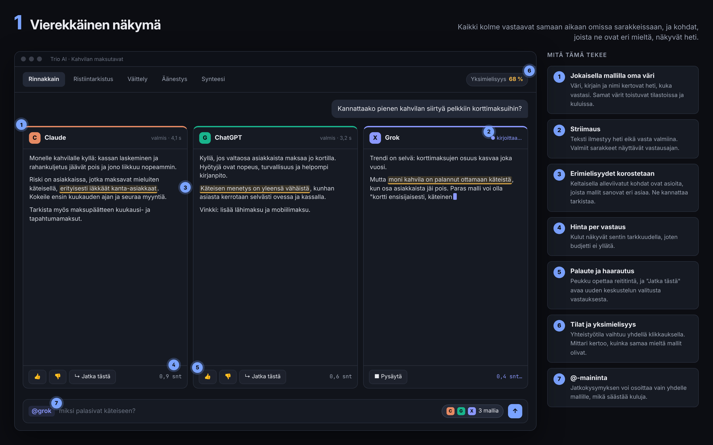
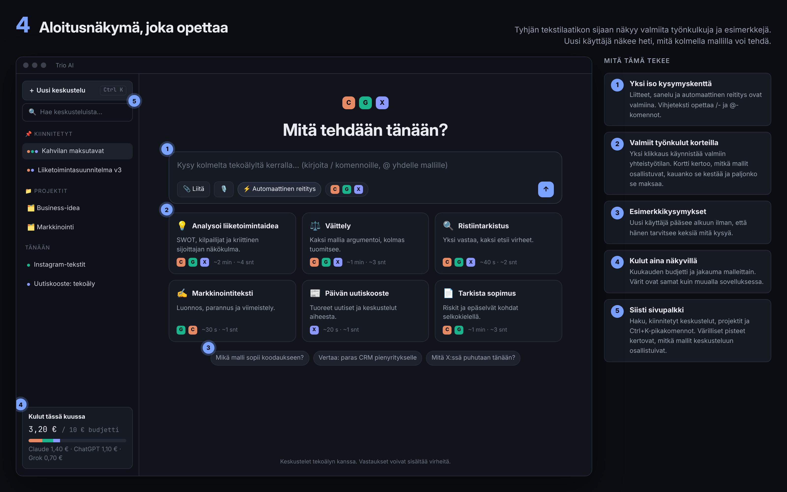

# Ominaisuusideat: Claude + ChatGPT + Grok -yhteissovellus

> **Ohje Claudelle (lue ensin):**
> Tämä tiedosto on ideapankki sovellukseen, jossa Claude (Anthropic), ChatGPT (OpenAI) ja Grok (xAI) toimivat samassa sovelluksessa ja tekevät yhteistyötä.
> 1. Tutustu ensin olemassa olevaan koodiin: rakenne, käytetyt kirjastot, miten mallien API-kutsut on tehty ja mitä alla olevista ominaisuuksista on jo toteutettu.
> 2. Kerro käyttäjälle lyhyesti, mitkä ideat ovat jo valmiina, mitkä osittain ja mitkä puuttuvat.
> 3. Ehdota toteutusjärjestys (aloita ⭐-merkityistä) ja toteuta ominaisuudet **yksi kerrallaan**. Varmista jokaisen jälkeen, että sovellus toimii, ennen kuin siirryt seuraavaan.
> 4. Noudata projektin olemassa olevia käytäntöjä (kieli, kehys, tiedostorakenne, tyyli). Älä vaihda teknologioita kysymättä.
> 5. API-avaimet pidetään aina ympäristömuuttujissa (`.env`), ei koskaan koodissa eikä gitissä.

> 6. Osiossa **6** on laaja ideapankki (110 ideaa). **Sinä saat itse päättää, mitkä niistä ovat järkeviä** (ks. osion 6 ohje).
> 7. Osiossa **7** on mallikuvat viidestä tärkeimmästä ulkoasuideasta (`docs/mockups/`). Niiden HTML/CSS-lähdekoodi on kansiossa `docs/mockups/src/`, ja sitä voi käyttää ulkoasun pohjana (värit, asettelu, komponentit).

⭐ = suositeltu toteutettavaksi ensimmäisenä

---

## 1. Yhteistyötilat: miten mallit toimivat yhdessä

Tavoite: jokaisen tilan voi valita käyttöliittymästä (esim. pudotusvalikko tai välilehdet).

### ⭐ 1.1 Ristiintarkistus
- Yksi malli (valittavissa) vastaa kysymykseen.
- Kaksi muuta mallia saavat vastauksen ja etsivät siitä virheitä, puutteita ja epätarkkuuksia.
- Lopuksi näytetään yhteenveto:
  - ✅ asiat, joista kaikki ovat samaa mieltä
  - ⚠️ asiat, joista ollaan eri mieltä (ja kuka sanoi mitä)
  - ❌ löydetyt virheet
- **Valmis kun:** käyttäjä näkee alkuperäisen vastauksen, molempien tarkistajien kommentit ja selkeän yhteenvedon.

### ⭐ 1.2 Väittely
- Kaksi mallia argumentoi aiheen eri puolia (puolesta / vastaan) N kierroksen ajan (oletus 2–3, säädettävissä).
- Kolmas malli toimii tuomarina: tiivistää argumentit ja antaa perustellun ratkaisun.
- Käyttäjä voi valita, mikä malli on missäkin roolissa.
- **Valmis kun:** väittely näkyy keskusteluna, jossa jokainen puheenvuoro on merkitty mallin nimellä, ja tuomarin päätös näkyy lopussa korostettuna.

### 1.3 Roolipohjainen työnjako
- Jokaisella mallilla on oletusrooli, esimerkiksi:
  - **Claude:** kirjoittaminen, analyysi, koodi, pitkät dokumentit
  - **ChatGPT:** ideointi, kuvien luonti, yleistehtävät
  - **Grok:** tuoreet uutiset, ajankohtaiset X/Twitter-keskustelut
- Sovellus pilkkoo monivaiheisen pyynnön osatehtäviksi ja jakaa ne roolien mukaan, ja lopuksi tulokset yhdistetään.
- Roolit muokattavissa asetuksista.

### 1.4 Äänestys
- Kaikki kolme vastaavat samaan kysymykseen.
- Jokainen malli äänestää parasta vastausta muiden vastauksista (ei omaansa) ja perustelee lyhyesti.
- Voittaja näytetään ensimmäisenä, muut alla.

### 1.5 Ketju / liukuhihna
- Malli A tekee luonnoksen → malli B parantaa → malli C viimeistelee.
- Järjestys valittavissa.
- Jokainen välivaihe näkyy (avattavina osioina), jotta muutokset voi seurata.

### 1.6 Konsensusmittari
- Kun kaikki mallit ovat vastanneet, lasketaan yksimielisyysaste (esim. pyytämällä yhtä mallia arvioimaan vastausten yhtäpitävyys asteikolla 0–100 %).
- Näytetään visuaalisena palkkina vastausten yläpuolella. Korkea yksimielisyys = luotettavampi vastaus.

### 1.7 Synteesi
- Kaikki vastaavat, minkä jälkeen yksi malli yhdistää parhaat palat yhdeksi lopulliseksi vastaukseksi ja merkitsee, mistä mallista mikin osa on peräisin.

---

## 2. Älykkyys ja muisti

### ⭐ 2.1 Automaattinen reititin
- Sovellus analysoi kysymyksen ja valitsee siihen sopivimman mallin, jolloin kaikkia kolmea ei tarvitse kutsua joka kerta. Tämä säästää kustannuksia.
- Aluksi yksinkertainen sääntöpohjainen tai halvalla mallilla tehty luokittelu (esim. "koodi" → Claude, "uutiset" → Grok, "kuva" → ChatGPT).
- Myöhemmin reititin voi oppia käyttäjän palautteesta (ks. 3.3).
- Käyttäjä näkee, miksi kyseinen malli valittiin, ja voi ohittaa valinnan.

### 2.2 Yhteinen muisti
- Kaikki mallit näkevät saman keskusteluhistorian ja projektin taustatiedot.
- Pitkissä keskusteluissa vanha historia tiivistetään automaattisesti, jotta kontekstiraja ei ylity.

### 2.3 Projektit / työtilat
- Käyttäjä voi luoda projekteja, joilla on omat:
  - ohjeet (esim. "vastaa aina suomeksi", "olet markkinointiasiantuntija")
  - tiedostot
  - keskusteluhistoria

### 2.4 Tiedostojen lataus
- Tuki ainakin PDF:lle, kuville ja Excel/CSV-tiedostoille.
- Ladattu tiedosto välitetään kaikille valituille malleille (huomioi, että mallien API:t tukevat eri tiedostotyyppejä eri tavoin; muunna tarvittaessa tekstiksi).

---

## 3. Kustannukset ja seuranta

### ⭐ 3.1 Kustannuslaskuri
- Jokaisen vastauksen alla: käytetyt tokenit (syöte / tuloste) ja arvioitu hinta.
- Kojelauta: kulut per päivä / kuukausi / malli.
- Kuukausibudjetti, josta varoitus esim. 80 %:n kohdalla, ja mahdollisuus pysäyttää kutsut budjetin täyttyessä.
- Hinnat yhdessä konfiguraatiotiedostossa, jotta niitä on helppo päivittää.

### 3.2 Nopeus- ja laatutilastot
- Seuraa: vastausaika, voittoprosentti (äänestyksistä ja käyttäjän palautteesta) ja mitkä aiheet sujuvat millekin mallille parhaiten.
- Näytä tilastosivulla kaavioina.

### 3.3 Palaute (peukku ylös/alas)
- Jokaiseen vastaukseen 👍 / 👎.
- Palaute tallennetaan ja sitä käytetään reitittimen (2.1) ja tilastojen (3.2) parantamiseen.

---

## 4. Käyttöliittymä

### ⭐ 4.1 Vierekkäinen näkymä
- Vastaukset rinnakkain sarakkeissa (mobiilissa välilehtinä tai pinottuna).
- Vastaukset näkyvät striimattuina, eli teksti ilmestyy sitä mukaa kuin se valmistuu.
- Kohdat, joissa mallit ovat eri mieltä, korostetaan.
- Jokaisella mallilla oma tunnusväri ja -kuvake.

### 4.2 Haarauta keskustelu
- "Jatka tästä" -painike minkä tahansa mallin vastauksen kohdalla → uusi keskusteluhaara, joka jatkuu siitä vastauksesta.

### 4.3 Äänitila
- Puheentunnistus kysymyksille.
- Mallien vastaukset luetaan ääneen, jokainen malli omalla äänellään.

### 4.4 Mobiili / PWA
- Sovellus asennettavissa puhelimen kotinäytölle (Progressive Web App).
- Responsiivinen ulkoasu.

---

## 5. Bisneskäyttö

### 5.1 Valmiit työnkulut (templatet)
Valmiita "yhden napin" työnkulkuja, joissa malleilla on valmiiksi mietityt roolit. Esimerkkejä:
- **Analysoi liiketoimintaidea:** yksi malli tekee SWOT-analyysin, toinen etsii kilpailijat ja markkinatilanteen (Grok: ajankohtainen tieto), kolmas toimii kriittisenä sijoittajana.
- **Kirjoita markkinointiteksti:** luonnos → parannus → lopullinen versio + vaihtoehtoiset otsikot.
- **Tarkista sopimus:** riskit, epäselvät kohdat ja yhteenveto selkokielellä.
- **Kirjoita sähköposti / LinkedIn-julkaisu**
- Käyttäjä voi tallentaa omia työnkulkujaan.

### 5.2 Tiimitilit
- Useampi käyttäjä samassa organisaatiossa.
- Jaetut projektit ja työnkulut.
- Käyttöoikeustasot (omistaja / jäsen / katselija).

### 5.3 Ansaintamalli (vaihtoehtoja)
- **Freemium:** ilmaisversiossa yksi malli ja rajattu määrä viestejä; maksullisessa kaikki kolme mallia ja yhteistyötilat.
- **Tuo omat avaimesi (BYOK):** käyttäjä syöttää omat API-avaimensa, ja sovellus on halvempi tai ilmainen.
- **Tiimihinnoittelu:** hinta per käyttäjä per kuukausi.

### 5.4 Raporttien vienti
- Keskustelun tai työnkulun tulos ladattavissa PDF-, Word- tai Markdown-tiedostona.
- Automaattinen tiivistelmä raportin alkuun.

---

## 6. Laajennettu ideapankki: 110 ideaa (Claude päättää)

> **Ohje Claudelle: sinä päätät.**
> Tämä lista on tarkoituksella laaja, eikä kaikkea kannata toteuttaa. Toimi näin:
> 1. Käy lista läpi vasta, kun tunnet olemassa olevan koodin.
> 2. Jaa ideat kolmeen ryhmään ja perustele lyhyesti:
>    - **Toteuta nyt:** suuri hyöty suhteessa työhön, sopii nykyiseen koodiin.
>    - **Myöhemmin:** hyvä idea, mutta vaatii ensin jotain muuta tai on iso työ.
>    - **Ei kannata:** ei sovi tähän sovellukseen, on päällekkäinen tai on liian kallis hyötyynsä nähden.
> 3. Näytä jako käyttäjälle ja odota hyväksyntä ennen toteutusta. Käyttäjä voi siirtää ideoita ryhmästä toiseen.
> 4. Kun valitset, painota: (a) toimiiko sovellus luotettavasti, (b) erottuuko se kilpailijoista juuri **kolmen mallin yhteistyön** ansiosta, (c) kustannukset käyttäjälle ja ylläpitäjälle.
> 5. Ideoissa, joissa mainitaan lait (EU:n tekoälyasetus, GDPR), suosittele käyttäjälle asiantuntijan tarkistusta ennen julkaisua.
>
> Merkinnät: **[S]** = pieni työ (tunteja), **[M]** = keskikokoinen (päiviä), **[L]** = iso (viikkoja). 🖼️ = mallikuva osiossa 7.

### A. Ulkoasu ja käyttöliittymä
1. 🖼️ **Mallikohtainen visuaalinen identiteetti:** jokaisella mallilla oma väri, kirjainkuvake ja nimi. Samat värit toistuvat kaikkialla (sarakkeet, kaaviot, kulut, sivupalkin pisteet). [S]
2. **Tumma, vaalea ja automaattinen teema** + aito musta OLED-näytöille. [S]
3. **Korostusvärin valinta** asetuksista. [S]
4. 🖼️ **Aloitusnäkymä, joka opettaa:** tyhjän laatikon tilalla valmiit työnkulkukortit (mallit, kesto, hinta-arvio) ja esimerkkikysymykset. [S]
5. **Ehdotetut jatkokysymykset** vastauksen alla klikattavina siruina. [S]
6. **Kaksivaiheinen latausnäkymä:** ensin "käsittelee…" tekstin kanssa ja sitten striimaus. Ei pyörivää kuvaketta alle sekunnin vastauksille. [S]
7. **Ajatteluosio (reasoning)** kokoontaitettavana, oletuksena kiinni. Otsikko ja sisältö erillään, ettei näkymä välky. [M]
8. 🖼️ **Edistymisvaiheet** monivaiheisille tiloille (esim. "Kierros 2/3", "Tarkistus 1/2"). [M]
9. 🖼️ **Työtila / canvas:** pitkä teksti tai koodi avautuu sivupaneeliin, jossa sitä muokataan. [L]
10. 🖼️ **Erojen korostus:** kohdat, joissa mallit sanovat eri asiaa, alleviivataan. [M]
11. 🖼️ **Väittelyareena-näkymä:** puheenvuorot aikajanana, puolet eri reunoilla, tuomarin päätöskortti ja pisteet. [M]
12. 🖼️ **Konsensusmittari ja väitekohtaiset merkit** (✓ / ! / ✕). [M]
13. **Komentopaletti (Ctrl/Cmd + K):** hae keskusteluja, vaihda tilaa, avaa asetukset ja käynnistä työnkulku näppäimistöltä. [M]
14. **Pikanäppäimet** + "?"-ohjeikkuna (uusi keskustelu, pysäytä, kopioi viimeisin, vaihda malli). [S]
15. **Koodilohkot:** syntaksikorostus, kopioi-nappi, kielimerkintä ja rivinumerot. [S]
16. **Markdown, taulukot ja matematiikka** (esim. KaTeX). [S]
17. **Kaaviot tekstistä:** Mermaid-kaaviot piirretään kuviksi. [S]
18. **Generatiivinen UI:** mallit voivat palauttaa vertailutaulukoita, kortteja tai kaavioita, jotka piirretään oikeina komponentteina. [L]
19. **Sivupalkki:** kokoontaitettava, haku, kiinnitetyt keskustelut, kansiot ja tagit. Värilliset pisteet kertovat, mitkä mallit osallistuivat. [M]
20. **Automaattiset otsikot** keskusteluille halvalla mallilla. [S]
21. **Mobiiliasettelu:** sarakkeiden sijaan pyyhkäistävät kortit tai välilehdet. [M]
22. **Kevyet mikroanimaatiot** (viestin ilmestyminen, napin palaute), jotka kunnioittavat `prefers-reduced-motion`-asetusta. [S]
23. **Fokustila:** sivupalkki ja turhat elementit piiloon kirjoittamisen ajaksi. [S]
24. **Tiheyssäätö:** tiivis / väljä näkymä. [S]
25. **Osittainen uudelleengenerointi:** maalaa vastauksesta kohta ja pyydä "korjaa vain tämä". [M]
26. **Toiminnot valitulle tekstille:** selitä, lyhennä, käännä, tee rennommaksi tai kysy toiselta mallilta. [M]
27. **Ystävälliset virhetilat:** jos yksi malli kaatuu, sen sarakkeessa näkyy selkeä viesti ja "Yritä uudelleen", ja muut toimivat normaalisti. [S]
28. **Kontekstilaatikko:** näyttää, mitkä tiedostot, muistit ja ohjeet vaikuttavat vastaukseen. [M]

### B. Mallien yhteistyö (uudet tavat)
29. **"Kysy toiselta" -nappi** jokaisessa vastauksessa: lähettää vastauksen toiselle mallille kommentoitavaksi. [S]
30. **Sokkovertailu (arena):** mallien nimet piilossa, käyttäjä äänestää parhaan, ja nimet paljastetaan lopuksi. Tuloksista syntyy oma tulostaulu. [M]
31. **Paholaisen asianajaja:** yksi malli etsii aina heikkoudet ja vastaväitteet. [S]
32. **Asiantuntijapaneeli:** mallit saavat roolit (esim. juristi, markkinoija, talousjohtaja), ja yhteenveto kootaan lopuksi. [M]
33. **Iteratiivinen parannus:** kirjoittaja ja arvioija vuorottelevat, kunnes arvioija hyväksyy, enintään N kierrosta. [M]
34. **Itsejohdonmukaisuus + ristiintarkistus:** sama kysymys kahdesti samalle mallille ja kerran toiselle. Erot paljastavat epävarmuuden. [M]
35. **Väitekohtainen faktantarkistus:** vastaus pilkotaan väitteiksi, ja jokainen tarkistetaan erikseen (tutkimusidea: FINCH-ZK). [L]
36. **Kaksivaiheinen tarkistus kulujen säästämiseksi:** tarkistajamallit kutsutaan vain, kun ensimmäinen vastaus vaikuttaa epävarmalta. [M]
37. **Toimintasuunnitelma ensin:** malli näyttää suunnitelman, käyttäjä hyväksyy tai muokkaa sen, ja vasta sitten se toteutetaan. [L]
38. **Väliintulo:** käyttäjä voi keskeyttää käynnissä olevan väittelyn tai ketjun ja antaa ohjeen. [M]
39. **Tiivistä keskustelu:** yksi nappi tekee koko keskustelusta yhteenvedon ja päätöslistan. [S]
40. **Mallien vahvuusprofiilit,** jotka päivittyvät palautteen ja äänestysten perusteella (esim. "Claude voittaa 70 % kirjoitustehtävistä"). [M]

### C. Luotettavuus ja laatu
41. **Lähdeviitteet:** kun käytetään verkkohakua, väitteiden perään tulee klikattavat lähteet. [M]
42. **Epävarmuusvaroitus,** joka perustuu mallien väliseen erimielisyyteen eikä mallin omaan arvioon varmuudestaan (tutkimusten mukaan se on epäluotettava). [S]
43. **Ajantasaisuusvaroitus:** kun kysytään tuoreita asioita, sovellus kertoo mallien tiedon katkaisupäivästä ja ehdottaa Grokia tai verkkohakua. [S]
44. **Muokkaa omaa viestiä ja lähetä uudelleen;** vanhat versiot säilyvät (← 1/3 →). [M]
45. **Vastausversiot:** "Generoi uudelleen" tallentaa vanhan version, ja niiden välillä voi selata. [M]
46. **Järjestelmäkehotteiden versiointi:** jokainen kehotemuutos tallennetaan, ja vanhaan voi palata. [M]

### D. Tuottavuus
47. **Kehotekirjasto:** tallennetut kehotteet, joissa on muuttujia (esim. `{{yritys}}`, `{{kohderyhmä}}`). [M]
48. **Slash-komennot:** `/väittely`, `/tarkista`, `/kuva`, `/tiivistä`. [S]
49. **@-maininnat:** `@claude`, `@chatgpt` ja `@grok` ohjaavat viestin tietylle mallille. [S]
50. **Omat ohjeet:** käyttäjän taustatiedot ja tyylitoiveet kaikille malleille. [S]
51. **Omat assistentit:** nimi, ohje, liitetiedostot ja oletusmallit (vrt. Poe-botit / GPT:t). [M]
52. **Haku kaikista keskusteluista** (koko teksti, ei vain otsikot). [M]
53. **Kiinnitä ja kirjanmerkitse viestejä.** [S]
54. **Vienti ja jako:** Markdown, PDF, Word, JSON sekä vain luku -jakolinkki. [M]
55. **Historian tuonti** ChatGPT:n ja Clauden vientitiedostoista. [M]
56. **Ajastetut tehtävät:** esim. "joka maanantai klo 8 uutiskooste Grokilta". [L]
57. **Tallenna muistiin -nappi:** vastauksen tärkeä kohta pysyvään muistiin. [S]
58. **Luonnoksen automaattinen tallennus,** ettei kirjoitettu viesti katoa. [S]
59. **"Paranna kehotettani" -nappi,** joka muotoilee käyttäjän kysymyksen tarkemmaksi ennen lähettämistä. [S]
60. **Monikielisyys:** käyttöliittymä suomeksi ja englanniksi (i18n), ja mallit vastaavat käyttäjän kielellä. [M]

### E. Työkalut ja integraatiot
61. **Verkkohaku työkaluna** kaikille malleille (esim. Brave Search API). [M]
62. **MCP-tuki (Model Context Protocol):** ulkoiset työkalut ja palvelut (Google Drive, Notion, GitHub) kaikkien mallien käyttöön. [L]
63. **Kuvien luonti** suoraan chatissa. [M]
64. **Kuvien ymmärrys:** liitä kuvakaappaus tai valokuva ja kysy siitä. [S]
65. **Koodin ajo turvallisessa hiekkalaatikossa** laskelmia ja kaavioita varten. [L]
66. **Tietopankki (RAG):** omat dokumentit haettaviksi, ja vastauksissa viittaukset dokumentin kohtiin. [L]
67. **Linkin liittäminen:** liitä URL, ja sivun sisältö haetaan malleille. [S]
68. **Liittäminen leikepöydältä ja raahaamalla** (kuvat ja tiedostot). [S]
69. **Selainlaajennus:** "Kysy kolmelta" mistä tahansa valitusta tekstistä verkossa. [L]
70. **Oma API ja webhookit,** jotta muut sovellukset voivat käyttää yhteistyötiloja. [L]

### F. Ääni ja mobiili
71. **Sanelu** (puhe tekstiksi). [M]
72. **Ääneenluku,** ja jokaisella mallilla oma äänensä. [M]
73. **Reaaliaikainen äänikeskustelu.** [L]
74. **PWA:** asennettava puhelimeen, ja historiaa voi lukea ilman verkkoa. [M]
75. **Ilmoitus, kun pitkä tehtävä on valmis** (väittely, raportti). [M]
76. **Jaa sovellukseen:** puhelimen jakovalikosta suoraan sovellukseen (share target). [M]

### G. Tekninen perusta, nopeus ja kustannukset
77. **Striimaus kaikille malleille** (SSE). [M]
78. **Rinnakkaiset kutsut ja oma aikaraja jokaiselle mallille.** [S]
79. **Uudelleenyritykset** kasvavalla viiveellä ja satunnaisuudella (jitter), ettei ruuhkassa synny kutsuryöppyä. [S]
80. **Varamalli:** jos yksi palvelu on alhaalla, käytetään toista mallia ja siitä kerrotaan käyttäjälle. [S]
81. **Kehotevälimuisti (prompt caching):** pitkät järjestelmäkehotteet ja dokumentit halvemmiksi palveluntarjoajien omalla välimuistilla. [S]
82. **Vastausvälimuisti** identtisille, faktapohjaisille kysymyksille (ei luoviin tehtäviin). [M]
83. **Kontekstin hallinta:** tokenien laskenta ja vanhan historian automaattinen tiivistys. [M]
84. **Pysäytä-nappi,** joka katkaisee striimauksen ja myös laskutuksen. [S]
85. **Seuranta:** jokaisen kutsun malli, tokenit, viive, hinta, virheet ja välimuistiosumat lokiin (esim. Langfuse). [M]
86. **Käyttäjäkohtaiset nopeusrajat** väärinkäytön estämiseksi. [S]
87. **Mallien nimet ja hinnat yhdessä konfiguraatiotiedostossa,** jotta uusiin malleihin on helppo vaihtaa. [S]
88. **Automaattiset testit ja laatutestit:** kiinteä kysymyssarja, jolla tarkistetaan, ettei kehotemuutos heikennä vastauksia. [M]
89. **Virheiden seuranta** (esim. Sentry). [S]
90. **Taustajonot pitkille tehtäville,** ettei selaimen sulkeminen katkaise väittelyä tai raporttia. [L]

### H. Turvallisuus, yksityisyys ja lait
91. **API-avainten salattu säilytys palvelimella** (myös käyttäjien omat avaimet), ei koskaan selaimessa. [M]
92. **Kehoteinjektion torjunta:** liitetyt dokumentit ja verkkosivut käsitellään datana, ei ohjeina. [M]
93. **Syötteen pituusrajat ja sisällön moderointi.** [S]
94. **EU:n tekoälyasetuksen läpinäkyvyys:** selvä merkintä, että käyttäjä keskustelee tekoälyn kanssa, ja tekoälyn luomat kuvat merkitään. Asetuksen 50. artiklan velvoitteet tulivat voimaan 2.8.2026. Tarkista asiantuntijalta. [S]
95. **GDPR:** tietosuojaseloste, omien tietojen vienti ja poisto sekä säilytysajat. [M]
96. **Yksityinen tila:** keskustelua ei tallenneta historiaan. [S]
97. **Kirjautuminen:** sähköposti, Google tai passkey, ja kaksivaiheinen tunnistautuminen. [M]

### I. Liiketoiminta ja kasvu
98. **Krediittimalli:** uusi käyttäjä saa ilmaiskrediittejä, ja saldo näytetään euroina. [M]
99. **Maksut ja tilaukset** (esim. Stripe), myös käyttöpohjainen laskutus. [L]
100. **Pehmeä raja:** kun ilmaiskäyttö loppuu, näytetään päivitystarjous kovan seinän sijaan. Rajalle osuvat käyttäjät ovat parhaita maksajaehdokkaita. [S]
101. **Kolmen askeleen esittelykierros** uudelle käyttäjälle. [S]
102. **Kutsu ystävä:** molemmat saavat krediittejä. [M]
103. **Ylläpitäjän kojelauta:** käyttäjät, kulut malleittain, suosituimmat tilat ja virheet. [M]
104. **Julkinen "mikä malli voitti" -tulostaulu** sokkotesteistä (markkinointisisältöä). [M]
105. **Jaettavat väittelyt:** kauniit julkiset sivut kiinnostavista väittelyistä, joista syntyy näkyvyyttä somessa. [M]

### J. Saavutettavuus
106. **Ruudunlukijat:** keskustelu `role="log"`-alueena, `aria-busy` striimauksen ajan ja vastaus luetaan vasta, kun se on valmis (ei sana kerrallaan). [M]
107. **Ei pelkkä väri:** mallit tunnistetaan aina myös nimestä tai kirjaimesta, ja kontrasti täyttää WCAG AA -tason. [S]
108. **Täysi näppäimistökäyttö** ja näkyvä fokus. [S]
109. **Vähennetty liike:** animaatiot pois, kun käyttäjä on niin valinnut. [S]
110. **Suurennus ei riko asettelua** (200 % zoom). [S]

---

## 7. Ulkoasun mallikuvat: 5 tärkeintä

Kuvat ovat kansiossa `docs/mockups/` ja niiden HTML-lähteet kansiossa `docs/mockups/src/`. Värit: Claude = oranssi `#E58A63`, ChatGPT = vihreä `#19B48C`, Grok = sininen-violetti `#8B98FF`. Kuvat ovat suuntaa-antavia luonnoksia. Sovita ne olemassa olevaan ulkoasuun, äläkä kopioi pikselintarkasti.

| # | Kuva | Mitä muuttaa | Liittyvät ideat (osiot 1–5 · #-numerot osiosta 6) |
|---|---|---|---|
| 1 |  | Kolme saraketta, mallien värit, striimaus, erimielisyyksien korostus, hinta per vastaus, @-maininta | 4.1, 3.1 · #1, #10, #49 |
| 2 |  | Yksimielisyysprosentti ja väitekohtaiset ✓ / ! / ✕ -merkit, kuka oli eri mieltä ja miksi | 1.1, 1.6 · #12, #35, #42 |
| 3 |  | Puolesta/vastaan-aikajana, edistymisvaiheet, tuomarin pisteet ja suositus, väliintulo | 1.2 · #8, #11, #38 |
| 4 |  | Työnkulkukortit hinta- ja aika-arvioineen, esimerkkikysymykset, kulumittari sivupalkissa | 5.1, 3.1 · #4, #5, #19, #94 |
| 5 |  | Chat ja dokumentti rinnakkain, väriviiva kertoo kirjoittajan, toiminnot valitulle tekstille, versiot, vienti | 5.4 · #9, #25, #26 |

---

## Ehdotettu toteutusjärjestys

1. **4.1 Vierekkäinen näkymä** (pohja kaikelle muulle, jos ei vielä ole)
2. **3.1 Kustannuslaskuri** (näkyvyys kuluihin heti alusta)
3. **1.1 Ristiintarkistus**
4. **2.1 Automaattinen reititin**
5. **1.2 Väittely**
6. **3.3 Palaute** → **3.2 Tilastot**
7. Loput yhteistyötilat (1.3–1.7)
8. Muisti ja projektit (2.2–2.4)
9. Bisnesominaisuudet (5.x) ja loput käyttöliittymäparannukset (4.2–4.4)

## Valmiita avoimen lähdekoodin projekteja: esikuvat ja lainattavat osat

> **Ohje Claudelle:** käytä näitä ensisijaisesti **mallina ja inspiraationa**. Ennen kuin kopioit koodia suoraan, tarkista projektin lisenssi:
> - **MIT / Apache-2.0:** kopiointi sallittu, kunhan alkuperäinen lisenssi- ja tekijänoikeusmerkintä säilytetään.
> - **GPL:** koko sovelluksen pitäisi silloin olla GPL. Älä kopioi koodia, ota vain ideoita.
> - **Oma lisenssi / ei lisenssiä:** älä kopioi koodia, ota vain ideoita.
>
> Tarkista myös, onko projekti yhä ylläpidetty. Älä ota mallia projekteista, jotka käyttävät selaimen kirjautumisia API-avainten sijaan, koska se voi rikkoa palveluntarjoajien käyttöehtoja.

### Yhteistyötilat (osio 1)
| Projekti | Mitä siitä kannattaa ottaa | Liittyy ideaan |
|---|---|---|
| [karpathy/llm-council](https://github.com/karpathy/llm-council) | Kolmivaiheinen "neuvosto": 1) kaikki mallit vastaavat, 2) mallit arvioivat ja järjestävät toistensa **anonymisoidut** vastaukset, 3) puheenjohtajamalli kokoaa lopullisen vastauksen. Pieni ja helppolukuinen. Esimerkkineuvostossa on mukana myös Claude, GPT ja Grok (OpenRouterin kautta). Tekijä ei ylläpidä projektia. | 1.4 Äänestys, 1.7 Synteesi, 1.1 Ristiintarkistus |
| [togethercomputer/MoA](https://github.com/togethercomputer/MoA) (Mixture-of-Agents) | Kerroksellinen malli: "ehdottajat" vastaavat, ja "kokoaja" yhdistää vastaukset. Kerroksia voi olla useita. Repossa on noin 50 rivin `moa.py`-esimerkki ja `advanced-moa.py`. Taustalla on tieteellinen artikkeli ([arXiv 2406.04692](https://arxiv.org/abs/2406.04692)). Alkuperäinen käyttää Togetherin API:a, joten kutsut pitää vaihtaa omiin malleihin. | 1.7 Synteesi, 1.5 Ketju |
| [abirharrasse/D3-Judge](https://github.com/abirharrasse/D3-Judge) | Rakenteellinen väittely: puolestapuhujat, tuomari ja valinnainen "valamiehistö". Hyvä malli väittelykierrosten ja tuomarin kehotteiden rakentamiseen. | 1.2 Väittely |
| [jonas-becker/problem-drift](https://github.com/jonas-becker/problem-drift) | Tutkimus siitä, miten pitkät väittelyt ajautuvat pois alkuperäisestä aiheesta. Opetus: rajoita kierrosten määrää ja muistuta malleja alkuperäisestä kysymyksestä joka kierroksella. | 1.2 Väittely |
| [ramtinz/multi-agent-debate-protocols](https://github.com/ramtinz/multi-agent-debate-protocols) | Vertailee eri väittely- ja äänestysprotokollia, myös tuomarimallin käyttöä. Hyödyllinen, kun valitaan miten äänet lasketaan. | 1.2 Väittely, 1.4 Äänestys |

### Mallien yhdistäminen yhteen rajapintaan (Tekniset huomiot)
| Projekti | Mitä siitä kannattaa ottaa | Kieli |
|---|---|---|
| [Vercel AI SDK](https://ai-sdk.dev) ([vercel/ai](https://github.com/vercel/ai)) | Yhteiset `generateText` / `streamText` -funktiot kaikille malleille. Omat paketit `@ai-sdk/anthropic`, `@ai-sdk/openai` ja `@ai-sdk/xai`. Mallin vaihto onnistuu yhtä riviä muuttamalla, ja striimaus on valmiina. **Paras vaihtoehto, jos projekti on JavaScript/TypeScript (esim. Next.js).** | TypeScript |
| [BerriAI/litellm](https://github.com/BerriAI/litellm) | Yksi OpenAI-tyylinen rajapinta yli 100 palveluntarjoajalle, myös xAI:lle. **Valmis kustannusseuranta ja budjettirajat** käyttäjä-/tiimi-/avainkohtaisesti. **Paras vaihtoehto, jos projekti on Python.** | Python |
| [OpenRouter](https://openrouter.ai) | Palvelu (ei avointa koodia), jolla kaikkiin malleihin pääsee yhdellä API-avaimella. llm-council käyttää tätä. Helppo aloittaa, mutta välikäsi ottaa pienen lisämaksun. | Mikä tahansa |

### Automaattinen reititin (2.1)
| Projekti | Mitä siitä kannattaa ottaa |
|---|---|
| [lm-sys/RouteLLM](https://github.com/lm-sys/RouteLLM) (Apache-2.0) | Reititin, joka ohjaa helpot kysymykset halvemmalle ja vaikeat tehokkaammalle mallille. Kynnysarvolla säädetään hinnan ja laadun tasapainoa. Tekijät raportoivat jopa 35–85 % säästöjä. Alkuperäinen on tehty kahdelle mallille (vahva/heikko), joten kolmelle mallille idea pitää soveltaa. Hyvä esikuva myös sille, miten käyttäjäpalautteesta (3.3) voi opettaa reititintä. |

### Käyttöliittymä (osio 4)
| Projekti | Mitä siitä kannattaa ottaa | Lisenssi |
|---|---|---|
| [ChatALL](https://github.com/ai-shifu/ChatALL) | Suosituin "kysy kaikilta kerralla" -sovellus. Esikuva vierekkäiselle näkymälle ja mallien valinnalle. | Apache-2.0 |
| [Open WebUI](https://docs.openwebui.com/features/chat-conversations/chat-features/multi-model-chats) | Monimallitila: useampi malli vastaa samassa keskustelussa, ja niiden alle saa **"Merged Response"** -yhdistelmävastauksen. Hyvä malli siitä, miltä 4.1 + 1.7 voisi näyttää yhdessä. | Oma lisenssi, joten vain ideaksi |
| [LibreChat](https://github.com/danny-avila/LibreChat) | Mallin vaihto kesken keskustelun niin, että historia säilyy. Lisäksi käyttäjätilit ja tiedostojen lataus. Esikuva osioille 2.2–2.4 ja 5.2. | MIT |
| [hraw297/polyai](https://github.com/hraw297/polyai) | Pieni Node.js-sovellus, joka kutsuu OpenAI:ta, Anthropicia, Googlea ja xAI:ta. Helppo lukea, ja hyvä vertailukohta API-kutsujen rakenteelle. | Tarkista |

---

## Tekniset huomiot

- Tee jokaiselle mallille yhteinen rajapinta (esim. `sendMessage(model, messages, options)` → `{ text, inputTokens, outputTokens, latency }`), jolloin yhteistyötilat on helppo rakentaa sen päälle eikä niiden tarvitse tietää, mitä API:a kulloinkin käytetään.
- Kutsu malleja rinnakkain aina kun mahdollista (esim. `Promise.all` / `asyncio.gather`).
- Käsittele virheet malleittain: jos yksi malli ei vastaa (aikakatkaisu, rajoitukset, virhe), muut tulokset näytetään silti ja virhe kerrotaan käyttäjälle selkeästi.
- Käytä kunkin palveluntarjoajan uusimpia ja parhaita malleja; pidä mallien nimet yhdessä konfiguraatiotiedostossa, jotta ne on helppo vaihtaa.
- API-avaimet: `ANTHROPIC_API_KEY`, `OPENAI_API_KEY`, `XAI_API_KEY` ympäristömuuttujissa. Lisää `.env` tiedostoon `.gitignore`.
