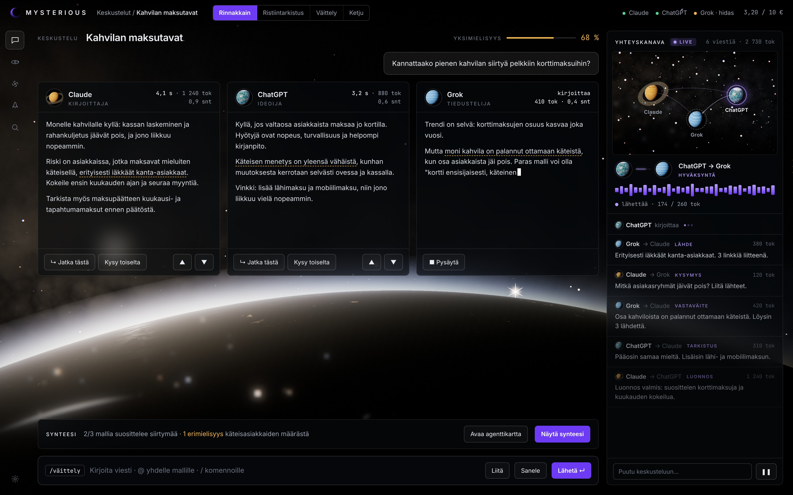
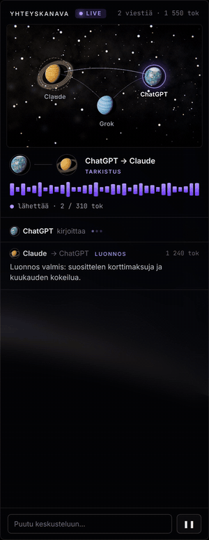

# Mysterious

Sovellus, jossa **Claude, ChatGPT ja Grok** (jokainen oman värisenä planeettanaan) toimivat yhdessä ja jakavat yhteisen muistin: ne vastaavat, tarkistavat toistensa työn ja väittelevät. Brändivärit ovat **musta ja liila**, ja ulkoasu on **realistinen avaruus** (Deep Field): oikea 3D-renderöinti ja hillitty, lennonjohtomainen käyttöliittymä. Oikeassa reunassa oleva **yhteyskanava** näyttää animaationa, kun mallit puhuvat toisilleen.

## Mistä aloittaa
1. **[IDEAS.md](IDEAS.md)** on koko tuotesuunnitelma: visio, 160 ideaa, ulkoasu ja toteutusjärjestys. Anna tämä tiedosto Claudelle: *"Lue IDEAS.md ja toimi sen ohjeiden mukaan."*
2. **[docs/space3d/](docs/space3d/)** sisältää toimivan three.js-3D-moottorin ja interaktiiviset prototyypit:
   - `mission-control.html`: päänäkymä planeetan horisontin yllä, oikealla yhteyskanava (`comms.js`)
   - `agent-map.html`: agenttikartta (mallit planeettoina, missio avaruusasemana)
   - `galaxy.html`: tiedostot spiraaligalaksina
   - `memory-galaxy.html`: **muistigalaksi**, jossa kaikkien mallien muistit ovat tähtinä ja klikkaus näyttää tiivistelmän
   - `design-system.html`: värit, fontit, komponentit ja realismin säännöt

   Avaaminen: aja repon juuressa `python3 -m http.server` ja avaa selaimessa `http://localhost:8000/docs/space3d/mission-control.html`.
3. **[docs/memory-vault/](docs/memory-vault/)** sisältää muistijärjestelmän: Obsidian-yhteensopivan holvin, esimerkkimuistit, skeeman ja mallien muistityökalut.
4. **[docs/mockups/](docs/mockups/)** sisältää kuvat ja videot:
   - 1–5: tärkeimmät toiminnot
   - 10–13: realistinen avaruusulkoasu
   - 14–15: yhteyskanavan animaatio ([koko näkymä, MP4](docs/mockups/14-yhteyskanava-paanakyma.mp4), [lähikuva, MP4](docs/mockups/15-yhteyskanava.mp4))
   - 17: muistigalaksi

**Logo:** tehdään erikseen. Korvaa paikkamerkki `docs/space3d/assets/logo.svg` oikealla logolla, niin se näkyy kaikissa näkymissä.

