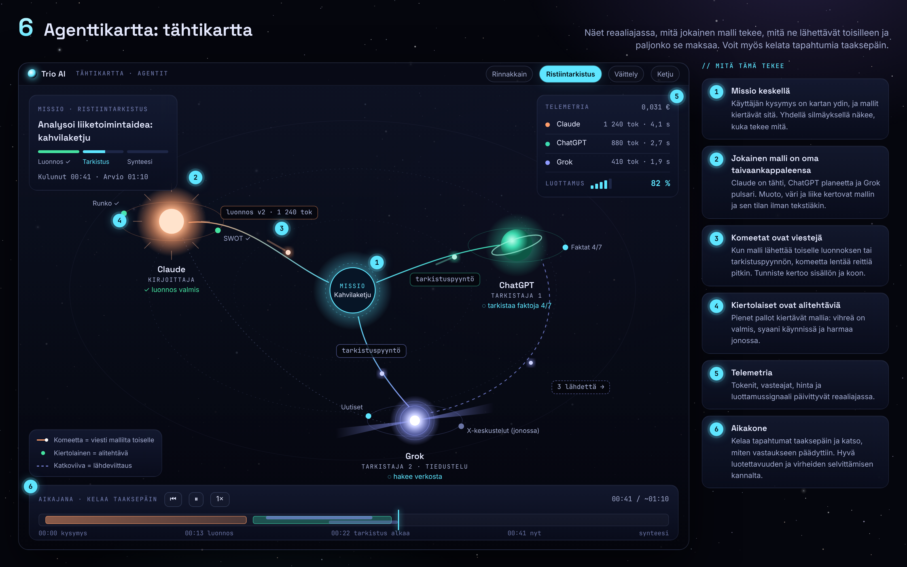

# Business-idea

Suunnitelma sovellukseen, jossa **Claude, ChatGPT ja Grok** toimivat yhdessä: ne vastaavat, tarkistavat toistensa työn ja väittelevät. Ulkoasu on avaruusteemainen.

## Mistä aloittaa
1. **[IDEAS.md](IDEAS.md)** on koko tuotesuunnitelma: visio, 160 ideaa, avaruusteema ja toteutusjärjestys. Anna tämä tiedosto Claudelle: *"Lue IDEAS.md ja toimi sen ohjeiden mukaan."*
2. **[docs/design/nebula.css](docs/design/nebula.css)** sisältää avaruusteeman värit, fontit ja efektit valmiina CSS-muuttujina.
3. **[docs/mockups/](docs/mockups/)** sisältää mallikuvat:
   - 1–5: tärkeimmät toiminnot (vierekkäinen näkymä, konsensusmittari, väittely, aloitusnäkymä, työtila)
   - 6–9: avaruusteema (agenttikartta, tiedostokartta, Mission Control -päänäkymä, design-järjestelmä)
   - `src/` ja `src-space/`: kuvien HTML-lähteet, joita voi käyttää ulkoasun pohjana. `src-space/6-agenttikartta.html` on animoitu: avaa se selaimessa.

